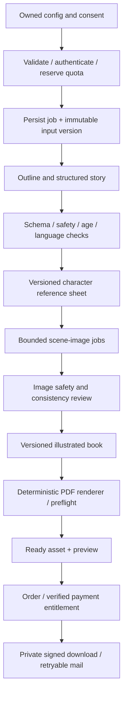

# Bubbleverse — AI workflow and production proposal

Audited source `71a0d853920771f3469160cf142de4944ab28b0c`, 2026-11-14. Current workflow is confirmed by source inspection only; no provider request was executed. All proposed stages below are future P0/P1 work, not completed features. Finding references resolve to AUDIT.md.

## Current workflow

1. StoryWizard collects length (8–10, 12–18, or 18–25 pages), comic/storyboard, style/custom style, language code, character names/roles/data-URL photos, interests and manual/auto plot. No child age, character visual description or stable reusable child profile is collected (`src/components/StoryWizard.tsx:50`, `CharacterUpload.tsx:29`).
2. Optional enhance-plot sends plot/interests, not language. Both functions manually validate a Bearer JWT using getClaims and query is_banned; query errors/missing profile are not rejected (`supabase/functions/enhance-plot/index.ts:16`, `generate-story/index.ts:33`). Gateway-level verify_jwt is false in config, so handler validation is the actual auth boundary; this is not an unauthenticated endpoint solely because that flag is false.
3. enhance-plot calls Lovable's chat-completions endpoint with `google/gemini-2.5-flash`, max_tokens 500. No persisted draft or prompt version.
4. storyService invokes generate-story with configuration, but explicitly maps characters to name/role only (`src/lib/storyService.ts:43`). Photos/embeddings do not reach the model.
5. generate-story randomly chooses a page count from the length range. Hardcoded system/user prompts request age 4–10 content, hero on every page, interests, selected style and language; user input is interpolated directly into instructions (`generate-story/index.ts:98–198`). No app_config read or moderation/age verification.
6. First AI call uses `google/gemini-2.5-flash`, temperature 0.8. It returns unstructured text expected to contain a JSON array. A greedy bracket regex and JSON.parse extract pages, without schema or semantic checks (`:202–260`). Provider 429/402 get friendly responses; other failures become 500s. There is no explicit timeout, bounded retry, circuit breaker or per-user spend enforcement.
7. Second call uses `google/gemini-2.5-flash-lite` to title the story from first-page text (`:263`). A non-OK title response falls back, but a thrown network/JSON error still fails the whole function. Fallback recognizes Arabic rather than ar, so Arabic-code requests get English fallback. The code en also incorrectly triggers the non-English warning in the story prompt.
8. All pages return to browser. Browser separately inserts a completed story, characters (including original data URLs) and pages. Child insert errors are ignored, and selected language/custom style are not preserved (`storyService.ts:71`). No atomic completion boundary.
9. Preview displays text/scene instructions only. All pages are available client-side, with CSS locking after three pages; PDF button is inert. No scene image generation, character-reference processing, regeneration implementation, PDF export or payment delivery follows.

Unused extension fields: characters.embedding_data, pages.generated_image_url/is_regenerated, stories.cover_image_url/pdf_url. Fields are compatibility hints, not working features. Schema and code also lack jobs, asset versions, model usage/cost tracking and orders.

## Can Lovable AI be retained outside Lovable?

**Confirmed:** the functions make ordinary server-side HTTP calls to `https://ai.gateway.lovable.dev/v1/chat/completions` using `LOVABLE_API_KEY`; browser does not call that gateway or need an editor runtime. Vite's lovable-tagger runs only in development. Preview auth falls back to localStorage on independent domains. The React app is therefore technically host-independent.

**Unverified:** whether the current account allows keys to be provisioned and used from independently hosted functions, acceptable commercial availability/SLA, credits, billing/control API, model lifecycle and rate limits, and child-data processing/retention/training/subprocessor terms. The repository/placeholder README cannot establish these. No key was supplied or tested, and no external claim of contractual portability is made.

**Recommendation:** retain the gateway provisionally for text if the owner verifies these conditions and a separately approved staging test succeeds. Independent frontend hosting alone is no reason to replace it. Add a narrow text-generation adapter with schema/error/usage contracts; keep endpoint/key server-side. If required portability, data terms, quota controls or reliability cannot be established, replace only that adapter with an approved direct provider. Do not assume an image-capable model/API is available under the same gateway contract; evaluate separately. No paid account/provider was introduced in this audit.

## Proposed production stages

Payment timing is a product decision: the diagram shows delivery entitlement, not a mandate to spend on every anonymous preview. Cap or reserve generation budgets before any provider work.

| Stage | Priority / dependency | Contract and failure behavior |
|---|---|---|
| Request boundary | P0 / A02–A04 | Derive owner from validated identity; reject missing/error profile, banned users, oversized/unrecognized inputs. Never accept client owner/status/price as authoritative. Atomic quotas/concurrency reservation and unique owner/idempotency key before call. |
| Durable jobs | P1 / A08–A09 | Store input version, state/stage, lease, attempt, deadline, cancel request, correlation ID, provider request ID, usage and sanitized error. Worker claims with lock/lease; restart resumes unfinished steps only. Poll authorized job data from existing animation screen. |
| Text planning and generation | P1 / A07, A14 | Canonical language code→name mapping and explicit age band; structured outline/pages/title schema. Stable character IDs, continuity facts, positive age-appropriate constraints and bounded lengths. Prefer title in validated story response where provider supports it; no need for a separate failure-prone call. |
| Validation and safety | P1 / A07 | Require expected page count, contiguous unique numbering, allowed layouts, nonempty bounded text, language correctness and full story arc. Treat parent free text as data and reject unsafe requests/output; enforce budgeted repair attempts and terminal safe failure. Provider filters alone are not proof of age suitability. |
| References | P1 / A05–A06 | Optional private consented photo → normalized reference/character sheet; explicit face/wardrobe/palette features tied to stable IDs. Do not store biometric embeddings by default; the existing embedding_data field is not a requirement. Keep parent approval/reference version for re-use. |
| Illustration | P1 / A10 | Scene spec references canonical character IDs, environment/pose/camera/style and deterministic controls supported by selected provider. Pass same approved references each scene; bounded parallelism. Never rely on a seed alone for identity consistency. Validate every returned image before private storage and version completion. |
| Composition/export | P1 / A11 | Renderer takes approved book JSON and owned image assets; browser preview and PDF share page ordering/layout rules. Draw narrative as text, not generated-image lettering. Embed licensed fonts, shape Arabic/RTL, validate overflow/margins/resolution and output checksum. |
| Commerce/delivery | P1 / A12 | Separate book readiness, order/payment and fulfillment status; verified idempotent webhook establishes entitlement. Expiring download links generated on demand; asynchronous receipt/delivery retries do not regenerate book or double-charge. |

Proposed state progression: queued → generating_text → validating_text → preparing_references → generating_images → composing_pdf → ready; explicit failed/cancel_requested/cancelled states and stage-specific attempts. Cancellation is best-effort for an already submitted provider request; UI must accurately disclose whether work/spend could finish. Avoid silently swallowing failures or setting ready while assets are absent.

## Persistence and consistency

Add jobs/steps/assets as needed, retaining stories/pages/characters as domain entities. Each output records book/config, prompt, model, reference and scene versions. Unique (story/version/page) prevents duplicate pages; composite ownership and constraints prevent cross-parent attachment. Commit content and valid state transitions transactionally. External calls are outside DB transactions; use durable intent, idempotency and reconciliation to handle the gap between external success and database write. Store object paths/checksums, never expiring URLs as asset identity.

## Reliability, cost and evaluation

Use explicit request timeouts; classify validation/auth failures as nonretryable, provider rate limits/transient network failures as bounded retry with jitter/Retry-After. Record token/image usage and estimated/actual charge, reconcile quota reservations, cap book retries and total spend, and stop when circuit/budget thresholds are reached. Platform edge execution limits must be measured before choosing an image/PDF worker. Do not add a paid queue or hosted renderer before approval.

Proposed evaluation suite uses synthetic data and covers supported age/language/style combinations, no-photo and multiple-family cases, continuity across all pages, unsafe/custom plot inputs, provider truncation/malformed JSON, repeat requests and resume after each stage failure. Human reviewers record age suitability, story coherence, visual consistency and layout quality against an agreed rubric; automate structural checks. Measure per-book completion rate, p50/p95 time, cost and scene retry rate before promising turnaround/pricing. None of these evaluations has been executed in this audit.

Future P3 print/video adapters consume immutable book/scene versions and use separate jobs/cost/fulfillment states. Preserve these interfaces without implementing either extension now.
