# Bubbleverse — current architecture

Audit date: 2026-11-14. Source: `aiplusone1-creator/Bubbleverse`, commit `71a0d853920771f3469160cf142de4944ab28b0c`. Audit branch: `audit/production-readiness`.

This describes checked-in source, not a verified deployment. All 135 tracked paths were inventoried: 103 under src, 14 under supabase, three public assets, and 15 root files. Review covered routes, business components, service/auth code, generated database types, both functions, all 11 migrations in timestamp order, build configuration, dependencies, and UI/animation structure. No production requests, database migrations, account creation, paid AI calls, or deployments were performed. Static evidence and executed checks are distinguished in [AUDIT.md](AUDIT.md).

## Assessment

The existing React/Supabase architecture can support the MVP without a rewrite. Preserve the visual shell, mascot, glass cards, bubbles, Tailwind tokens, Framer Motion animations, and English/Arabic interface. Add trusted backend workflow boundaries, durable generation state, private media handling, export, and commerce incrementally. This is an early text-generation prototype, not yet a complete illustrated-book product.

## Runtime and trust boundaries

```mermaid
flowchart LR
  Parent[Parent browser] --> SPA[React 18 / TypeScript / Vite]
  SPA --> Auth[Supabase Auth]
  SPA --> DB[Postgres through Supabase Data API / RLS]
  SPA --> Storage[Storage: admin example uploads]
  SPA --> EF[generate-story / enhance-plot]
  EF --> Claims[JWT claims and profile ban check]
  EF --> AI[Lovable AI gateway / Gemini text models]
  AI --> EF
  EF --> SPA
  SPA --> Save[Separate story / character / page inserts]
  Save --> DB
```

Source: `src/App.tsx:1`, `src/lib/storyService.ts:34`, `src/integrations/supabase/client.ts:1`, `supabase/functions/generate-story/index.ts:29`, `supabase/functions/enhance-plot/index.ts:11`.

The browser is currently both workflow coordinator and persistence coordinator. It receives the complete story before saving it. No queue, worker, payment API, image-generation API, PDF renderer, or email-delivery service is implemented. Supabase functions use the caller's authorization and anon key, not a service-role database client. Gateway credentials are read server-side.

## Frontend map and customer journeys

| Route / entry | Current journey and state | Evidence |
|---|---|---|
| `/` | Animated landing page, mascot toggle, theme/language controls, database-backed examples and floating showcase images. Examples display covers, not navigable complete example books. | `pages/Index.tsx`, `HeroSection.tsx`, `ExamplesSection.tsx`, `HeroShowcase.tsx` under src |
| `/auth` | Email signup, confirmation redirect, password login, Google OAuth initiation, signout elsewhere. External provider/mail configuration unverified. No password recovery UI. | `src/pages/Auth.tsx:45` |
| Home → Start Creating | Four in-memory wizard steps: length/format/style/language; names/roles/photos; interests and auto/manual plot; review. Hero and names validated in the browser. No reusable child record or age field. | `src/components/StoryWizard.tsx:50` |
| Manual plot → sparkle | Calls authenticated `enhance-plot`; replaces textarea with returned text. Selected story language is not sent. | `src/components/CustomPlotInput.tsx:17` |
| Generate | Session required only at invocation; synchronous text request, simulated progress, then three browser-side database insert operations. Cancel navigates away without aborting work. Signed-out parents can configure then hit an authentication error; no persisted draft/return path. | `StoryWizard.tsx:208`, `src/lib/storyService.ts:34` |
| Generation → preview | In-memory carousel of scene descriptions and narrative. After three pages a browser-only lock obscures content for non-admins. All pages already reached the browser. No illustrations. | `src/components/StoryPreview.tsx:59` |
| Preview → purchase/download | Upgrade shows “Coming soon”; PDF button has no handler. No checkout, order, receipt, or delivery flow. | `StoryPreview.tsx:72`, `StoryPreview.tsx:261` |
| `/profile` | Metadata name editing, signout, theme/language and saved currency preference. My Stories always renders an empty state; cannot reopen saved stories. | `src/pages/Profile.tsx:86`, `src/pages/Profile.tsx:233` |
| `/admin` | Profile/story counts and seven-day charts. Active-user count actually counts story rows. | `src/pages/admin/AdminOverview.tsx:30` |
| `/admin/users` | List profiles; toggle premium/ban flags. Roles enforced by database policy, with a profile-field authorization gap. | `src/pages/admin/AdminUsers.tsx:38` |
| `/admin/stories` | List, search, soft-delete/restore; opens pdf_url if one exists. No producer for that PDF in repository. | `src/pages/admin/AdminStories.tsx:55` |
| `/admin/config` | Edit stored prompt strings. Neither generation function reads them. | `src/pages/admin/AdminConfig.tsx:30` |
| `/admin/examples` | CRUD, visibility/order, public example-image uploads. | `src/pages/admin/AdminExamples.tsx:65` |
| `/admin/showcase` | CRUD and visibility for hero images. Unlike other admin screens this lacks AdminLayout/auth guard; RLS remains the write boundary. | `src/pages/admin/AdminShowcase.tsx:194` |
| `/admin/brand` | Static logo SVG/PNG exports, independent of story PDF export. | `src/pages/admin/AdminBrand.tsx:1` |
| Other URLs | Not-found page. No durable book route, order route, recovery route, or legal-policy routes. | `src/App.tsx:37` |

Paths abbreviated in table cells refer to named files under src/components unless qualified. AdminLayout redirects non-admins for the pages that use it; page hooks can still initiate requests before the layout check. RLS is essential even when UI guards exist.

## Data model: migration-derived final state

| Entity | Relationships and purpose | Important limitations |
|---|---|---|
| stories | Nullable user_id → auth.users; title/status, length/format/style, plot/interests, language, cover/PDF URLs, soft deletion | Browser writes completed before child inserts; language defaults en and is not saved from wizard; no job/payment state |
| characters | Nullable story_id → stories, nullable user_id → auth.users; name/role, original_image_url, embedding_data | Story-specific, not reusable family profiles; photos are data URLs; embedding_data unused |
| pages | Nullable story_id → stories, nullable user_id → auth.users; page number/layout/scene/text/image URL, regeneration flag | Image URL unused; page-number index is not unique; no owner/parent composite constraint |
| profiles | Unique non-null user_id; display_name/avatar, premium/ban, preferred_currency | Owner insert/update policies do not protect administrative fields; name editing updates auth metadata instead |
| user_roles | user_id and enum role; unique pair | Admin-managed; signup assigns user and an email-specific admin exception |
| app_config | Unique key, value, description, updated_by | Readable to authenticated users; unused by generation |
| examples | Public visible rows; admin CRUD | Public cover URLs; sample Unsplash seed assets |
| showcase_images | Public active rows; admin CRUD | Public image URLs, not private child references |

Sources: initial schema migration `20260105130110_*`, ownership migration `20260110233449_*`, admin schema `20260110233853_*`, subsequent email removal, examples, and showcase migrations. All names in this paragraph are unique migration prefixes; see full paths in SECURITY.md. Generated types in `src/integrations/supabase/types.ts` represent these tables but are not evidence of deployed schema.

Stories cascade deletion to pages/characters; user deletion cascades user-linked rows. Object cleanup is not implemented. Parent/child ownership must be enforced explicitly, not inferred from matching foreign keys.

## Authentication and storage

Supabase sessions persist with auto-refresh. `previewAuthStorage.ts` uses localStorage on independent domains and an origin-restricted postMessage broker on recognized framed Lovable preview hosts. Independent hosting therefore does not require the editor broker. Production session/CSP behavior remains untested.

Final checked-in storage policies make `character-images` private and scope paths by first folder = auth.uid(), plus admin read access. Earlier public policies are removed by a later migration; do not report the initial public state as the final policy. Actual child upload UI does not use this bucket: FileReader creates a base64 data URL, later inserted into characters.original_image_url. `example-images` is intentionally public with admin-only writes. No generated-illustration/PDF bucket or signed-download flow is defined.

## External requirements and unknowns

| Dependency | Configuration / provisioning required | Verification |
|---|---|---|
| Node/npm and static SPA host | Vite build; HTTPS/domain; history fallback for BrowserRouter | Local build checked; host configuration absent |
| Supabase | Postgres/RLS migrations, Auth, Storage, deployed Deno functions | Source only; no live schema/policy verification |
| Browser Supabase config | VITE_SUPABASE_URL, VITE_SUPABASE_PUBLISHABLE_KEY; tracked .env also names VITE_SUPABASE_PROJECT_ID | Values intentionally omitted; publishable key is not a server secret |
| Function environment | SUPABASE_URL, SUPABASE_ANON_KEY, LOVABLE_API_KEY | Presence/validity in deployment unverified |
| Auth delivery | SMTP/sender configuration, confirmation and recovery redirects; Google OAuth client/secret if retained | No operational configuration supplied |
| Lovable gateway | Account/key, credits, Gemini model availability, privacy terms and limits | No paid calls made; portability decision in AI_PIPELINE.md |
| Remote resources | deno.land and esm.sh function imports; Google Fonts; Unsplash seed images | Needed for current dependency/assets path; availability not end-to-end tested |
| Missing MVP infrastructure | Image-model provider, durable jobs, PDF execution environment, approved payment merchant/provider, webhook secrets, delivery mail, monitoring/backups | Decisions/provisioning still required; no paid services introduced |

## Production evolution without a rewrite

Retain React/Vite and Supabase. Add narrowly scoped migrations and server APIs for immutable book configuration, owned media, durable jobs/steps, versioned assets and orders. Use a Postgres job table with a compatible worker initially if platform limits permit; benchmark before choosing additional infrastructure. Keep provider adapters server-side. Store book content/version separately from sale entitlement and future fulfillment status. Future hardcover and video adapters should consume the same versioned book/scene assets; neither is implemented in this phase.

P0/P1 blockers and verification gates are in [MVP_ROADMAP.md](MVP_ROADMAP.md). P2 includes route splitting, admin pagination/metrics, accessibility/reduced motion and broader localization. P3 includes hardcover and animated video integrations.
