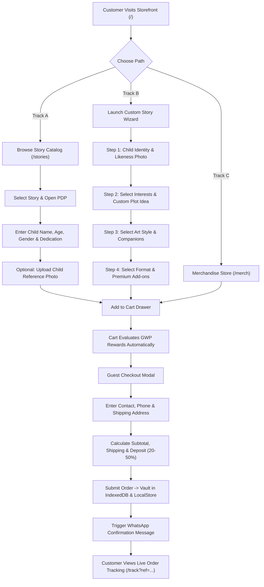
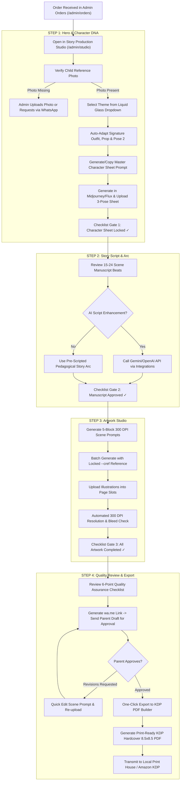
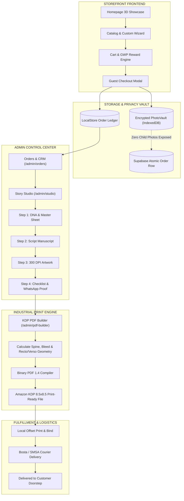

# BUBBLEVERSE™ MASTER SPECIFICATION, ARCHITECTURE BLUEPRINT & SYSTEM CONSTITUTION (2026)
**Official Technical, Operational, and Architectural Reference Document**  
*Version 3.0 — Production Standard — Amazon KDP 8.5"×8.5" Hardcover Certified*

---

## TABLE OF CONTENTS
1. [EXECUTIVE OVERVIEW & PRODUCT VISION](#1-executive-overview--product-vision)
2. [CORE STORY ENGINE & PERSONALIZATION LOGIC](#2-core-story-engine--personalization-logic)
   - 2.1 The Two Operational Story Tracks: Catalog vs. Bespoke
   - 2.2 Character DNA & Hero Likeness Lock Architecture
   - 2.3 The 10 Dynamic Story Themes & Auto-Adaptation Engine
   - 2.4 Stage 2 5-Block KDP Prompt Engineering Formula
   - 2.5 Multi-Language Arc & Zero-Repetition Manuscript Generator
3. [THE 10 ADMIN PANEL MODULES (DEEP DIVE & SOP)](#3-the-10-admin-panel-modules-deep-dive--sop)
   - 3.1 Module 1: Story Production Studio (`/admin/studio`)
   - 3.2 Module 2: Orders & Customer Vault (`/admin/orders`)
   - 3.3 Module 3: Story Catalog & Regional Pricing (`/admin/catalog`)
   - 3.4 Module 4: Amazon KDP 8.5"×8.5" Hardcover PDF Builder (`/admin/pdf-builder`)
   - 3.5 Module 5: Merchandise Catalog & GWP Engine (`/admin/merch`)
   - 3.6 Module 6: Homepage Showcase & 3D Interactive Bookshelf (`/admin/showcase`)
   - 3.7 Module 7: Growth & Retention CRM (`/admin/growth`)
   - 3.8 Module 8: API & External Integrations Hub (`/admin/integrations`)
   - 3.9 Module 9: Executive Business Intelligence & Analytics (`/admin/overview`)
   - 3.10 Module 10: B2B & Schools Portal (`/admin/b2b` & `/schools`)
4. [SYSTEM TOPOLOGY & COMPLETE FLOWCHARTS](#4-system-topology--complete-flowcharts)
   - 4.1 Flowchart 1: End-to-End Customer Journey
   - 4.2 Flowchart 2: The 4-Step Story Production & Proofing Pipeline
   - 4.3 Flowchart 3: Data, PhotoVault & External Integrations Topology
   - 4.4 Flowchart 4: Grand Unified System Architecture Mega-Diagram
5. [THE OFFICIAL BUBBLEVERSE ENGINEERING & OPERATIONAL CONSTITUTION](#5-the-official-bubbleverse-engineering--operational-constitution)
   - Article I: Core Mission & Product Boundaries
   - Article II: Tech Stack Sovereignty & Architectural Governance
   - Article III: Child Photo Privacy & Zero-Leak Vault Protocol
   - Article IV: Amazon KDP Hardcover Mathematical Standard
   - Article V: Stage 2 AI Prompt Contract & Character DNA Locking
   - Article VI: Multi-Currency Pricing & Commerce Integrity
   - Article VII: Liquid Glass UI & Design System Standards
   - Article VIII: Quality Assurance, Verification & Zero-Warning Law
   - Article IX: Operational Policies, Margin Floors & Manufacturing SOPs
   - Article X: WhatsApp Proofing & Customer Satisfaction Guarantee
6. [HANDOFF DIRECTIVES FOR FUTURE DEVELOPERS & AI AGENTS](#6-handoff-directives-for-future-developers--ai-agents)

---

# 1. EXECUTIVE OVERVIEW & PRODUCT VISION

Bubbleverse™ is a premier personalized storytelling and children's literature technology company. Our core mission is to transform any child into the illustrated hero of their own premium hardcover storybook.

### The Problem We Solve
Traditional children's books are passive and generic. Modern parents desire deeply engaging educational keepsakes that instill confidence, empathy, and a passion for reading. However, existing automated AI book generators produce disjointed art styles, deformed faces, hallucinated plots, and sub-par print quality.

### The Bubbleverse Solution
Bubbleverse bridges the gap between state-of-the-art Generative AI and traditional high-end publishing craftsmanship:
1. **Face & Identity Fidelity**: Using our proprietary Character DNA pipeline, we lock the child's exact facial structure, eye shape, skin tone, hairstyle, and signature outfit across all 15–24 illustrated pages.
2. **Pedagogical Narrative Quality**: Stories follow a proven emotional 3-act narrative arc designed for children aged 3–8, delivering meaningful life values (courage, kindness, teamwork, curiosity) with zero text repetition.
3. **Amazon KDP 8.5"×8.5" Precision Print Standards**: All interior layouts and exterior full-bleed wrap covers are mathematically calibrated for Amazon KDP Hardcover, IngramSpark, and local high-volume offset print houses at 300 DPI.
4. **Human-in-the-Loop Studio**: Combining automated AI assistance with administrative review, parent WhatsApp proofing, and strict checklist gates ensures 100% customer delight before any book is printed.

---

# 2. CORE STORY ENGINE & PERSONALIZATION LOGIC

## 2.1 The Two Operational Story Tracks: Catalog vs. Bespoke

To balance high-volume commercial scalability with bespoke personalization, Bubbleverse implements two distinct operational tracks:

```
┌────────────────────────────────────────────────────────────────────────┐
│                        BUBBLEVERSE STORY TRACKS                        │
├───────────────────────────────────┬────────────────────────────────────┤
│   TRACK A: PRE-SCRIPTED CATALOG   │      TRACK B: BESPOKE WIZARD       │
│           (Wonderbly Model)       │           (Full Custom)            │
├───────────────────────────────────┼────────────────────────────────────┤
│ • Fixed narrative backbone & core │ • 100% unique manuscript generated │
│   pedagogical themes.             │   from parent's custom plot idea.  │
│ • Predictable, award-winning text │ • Tailored child interests (dinos, │
│   calibrated by age group.        │   space, drawing, sports).         │
│ • Deep personalization of Name,   │ • Dynamic co-hero/companion        │
│   Gender, Age, Likeness & Dedic.  │   integration.                     │
│ • Instant storefront preview.     │ • Customized art direction choice. │
└───────────────────────────────────┴────────────────────────────────────┘
```

### Why Both Tracks Exist:
- **Track A (Catalog)**: Proven, risk-free commercial products (e.g. *Hero of the Lost Bubble Galaxy*, *Gentle Dinosaur Guardian*, *Little Traveler*). Parents know the exact theme, while the illustrations star their specific child.
- **Track B (Bespoke)**: Ultra-personalized milestone gift. When a parent has a specific story in mind (e.g., *"My daughter saving our family cat from an alien tree"*), the AI Story Studio crafts a bespoke manuscript from scratch.

---

## 2.2 Character DNA & Hero Likeness Lock Architecture

The foundation of visual continuity across an illustrated storybook is the **Character DNA**:

```typescript
export interface CharacterDna {
  childName: string;
  childAge: string;
  childGender: 'boy' | 'girl';
  hairAndFeatures: string;
  signatureOutfit: string;
  artStyle: string;
  midjourneyCrefUrl?: string;
  storyTheme?: string;
  signatureProp?: string;
  pose2Description?: string;
}
```

### The Turnaround Character Sheet (3 Poses):
Before generating any story pages, Step 1 of the Story Studio locks the **Master Character Sheet** containing three side-by-side poses on a soft neutral cream background:
1. **Pose 1**: Front facing smiling, looking directly into the camera.
2. **Pose 2**: 3/4 view in dynamic thematic stance, holding the child's signature prop (or hands on hips).
3. **Pose 3**: Happy, excited, joyful expression.

Once uploaded, this sheet serves as the permanent `--cref` (Character Reference) or PuLID/IP-Adapter anchor across all scene illustration prompts.

---

## 2.3 The 10 Dynamic Story Themes & Auto-Adaptation Engine

Unlike legacy generators with hardcoded bubble jacket outfits and glowing bubble props, the Stage 2 Prompt Engine (`stage2PromptEngine.ts`) features 10 intelligent thematic presets:

| Theme Key | Arabic Label | English Label | Signature Outfit (Boy / Girl) | Signature Prop & Pose 2 |
|---|---|---|---|---|
| `dinosaurs` | الديناصورات | Dinosaurs & Prehistoric | Safari paleontologist khaki vest, cargo shorts, trail boots | Magnifying glass inspecting mini dinosaur footprint |
| `space` | الفضاء | Space & Cosmic Flight | Junior astronaut jumpsuit, planetary mission patches, moon boots | Glowing miniature celestial star or brass telescope |
| `ocean` | أعماق البحار | Ocean & Deep Sea | Sea-teal marine explorer windbreaker, nautical navy shorts | Glowing iridescent ocean pearl or sea shell |
| `fantasy` | السحر والخيال | Fantasy & Fairy Tale | Young apprentice magical tunic, starry midnight-blue cape | Enchanted glowing crystal lantern or stardust wand |
| `superhero` | الأبطال الخارقين | Superhero Champions | Heroic hooded jacket with radiant star emblem, high-tops | Confident heroic standing pose with hands on hips |
| `animals` | رعاية الحيوانات | Animal Care & Vet | Mint-and-cream veterinary coat with paw-print pocket | Woodland animal stethoscope or plush bunny |
| `bedtime` | ما قبل النوم | Bedtime & Starlight | Cozy starlight pajamas with embroidered cloud details | Cuddly bedtime plush companion or warm crescent moon |
| `graduation` | التخرج والنجاح | Little Graduation Day | Celebratory blazer with golden milestone badge, crisp shirt | Golden diploma certificate ribbon or graduation cap |
| `custom` | قصة مخصصة | Custom Bespoke Quest | Modern vibrant hooded adventure jacket, clean white tee | Inquisitive explorer stance with hands cheerfully on hips |
| `bubble` | مجرة الفقاعات | Bubble Galaxy Quest | Junior explorer jacket with luminous cyan piping | Glowing floating starlight bubble |

---

## 2.4 Stage 2 5-Block KDP Prompt Engineering Formula

Every scene illustration prompt is engineered strictly using the **5-Block Stage 2 Formula** calibrated for Amazon KDP 8.5"×8.5" square full-bleed printing:

```
[BLOCK 1: ART DIRECTION & SCENE TITLE]
3D Pixar Storybook, rich pastel lighting, expressive character features. Children's storybook illustration for "Hero of the Lost Bubble Galaxy" — Page 03 of 15.

[BLOCK 2: CHARACTER DNA & LIKENESS LOCK]
Starring 5-year-old boy Adam as the hero (natural curly dark hair, warm eyes, natural cheerful smile), wearing junior astronaut jumpsuit with planetary mission patches. Faithful facial likeness matching the reference turnaround sheet.

[BLOCK 3: ACTION & EMOTION]
Adam kneeling gently beside a shimmering crystal console, touching a glowing beacon button with an expression of pure awe and excitement.

[BLOCK 4: ENVIRONMENT & LIGHTING]
Aboard the cockpit of a cozy starlight observatory spaceship, panoramic glass dome revealing swirling purple nebulae and golden shooting stars outside. Soft cinematic rim lighting.

[BLOCK 5: KDP COMPOSITION & NEGATIVE SAFEGUARDS]
Keep the child's face and important details strictly inside the center 75% safe zone (away from 0.375" KDP 8.5"×8.5" trim edges). Leave softer darker space near the bottom 25% for storybook text card. No text, no letters, no speech bubbles, no watermark, no borders, no cropped head, no extra fingers. --ar 1:1
```

---

## 2.5 Multi-Language Arc & Zero-Repetition Manuscript Generator

Bubbleverse generates stories in Arabic (`ar`) and English (`en`), respecting grammatical gender agreements and age vocabulary:
- **10-Page Arc**: Swift milestone adventure for toddlers (Ages 2–4).
- **15-Page Arc**: Standard flagship storybook (Ages 4–7).
- **20–24 Page Arc**: Comprehensive chaptered picture book (Ages 6–9+).
- **Zero-Repetition Algorithm**: Each page maps to a distinct dramatic beat index (`beginning`, `inciting incident`, `rising action`, `midpoint discovery`, `climax`, `resolution`, `homecoming`). Identical phrases or sentence structures across pages are strictly forbidden.

---

# 3. THE 10 ADMIN PANEL MODULES (DEEP DIVE & SOP)

## 3.1 Module 1: Story Production Studio (`/admin/studio`)

**Business Purpose**: The primary manufacturing workstation. The studio allows editors and administrators to link customer orders, lock character sheets, review and edit story text, generate/copy 300 DPI illustration prompts, verify print resolution, execute WhatsApp approvals, and export to the PDF builder.

```
┌────────────────────────────────────────────────────────────────────────┐
│                   STORY STUDIO 4-STEP PRODUCTION PIPELINE              │
├─────────────────┬──────────────────┬─────────────────┬─────────────────┤
│     STEP 1      │      STEP 2      │     STEP 3      │     STEP 4      │
│  Hero Profile   │   Story Script   │ Scene Artwork & │ Quality Review  │
│ & Character DNA │  & Arc Reviewer  │ 300 DPI Prompts │ & KDP Export    │
└─────────────────┴──────────────────┴─────────────────┴─────────────────┘
```

### Key UI Features:
1. **Interactive Guided Pipeline**: 4 step navigation tabs with live progress badges (`مقفول ✓` / `جاهز` / `مطلوب`) plus an "All-in-One" overview toggle.
2. **Order Selector Strip**: Seamlessly load any customer order. Populates child name, age, gender, art style, and detected story theme.
3. **Child Reference Photo Vault**: Displays high-resolution uploaded photos. Features direct file upload/replace dropzones and WhatsApp photo request button.
4. **Master Character Sheet Slot**: Displays locked 3-pose sheet, live auto-generated prompt, and direct upload button with instant checklist gate.
5. **Theme & Persona Dropdown**: Liquid Glass dropdown with 10 themes, instantly updating outfit, prop, and pose (2).
6. **Global Art Direction**: Liquid Glass dropdown + manual prompt editor with "Sync All" button.
7. **Manuscript Reviewer (Step 2)**: Full book text read-through and per-scene text editor with AI script enhancement.
8. **Artwork Studio (Step 3)**: Per-scene 300 DPI prompt generator, image uploader, and print resolution validator.
9. **Quality Gate & Checklist (Step 4)**: 6-point checklist, WhatsApp proof dispatch, and one-click PDF builder launch.

### Standard Operating Procedure (SOP):
1. Select the target customer order from the top dropdown.
2. Verify the child reference photo. If missing, click "Upload Child Photo" to attach the parent's WhatsApp photo.
3. Verify or adjust the Story Theme and Art Direction.
4. Copy the `Master Character Sheet Prompt` to Midjourney/Flux. Once generated, upload the 3-pose sheet to lock Step 1.
5. Review the text manuscript in Step 2 for grammatical polish.
6. Copy scene prompts in Step 3, generate illustrations, and upload each 300 DPI image.
7. Confirm all 6 checklist items in Step 4, send the WhatsApp proof to the parent, and click "Export to KDP PDF Builder".

---

## 3.2 Module 2: Orders & Customer Vault (`/admin/orders`)

**Business Purpose**: Central commerce operations, order intake, payment verification, fulfillment tracking, and CRM customer records across Egypt, Saudi Arabia, and UAE.

### Key Features:
1. **Multi-Currency Intake**: Native support for EGP, SAR, and AED with automatic deposit calculation.
2. **Order Status State Machine**:
   - `pending_deposit` → `deposit_confirmed` → `in_preparation` → `draft_ready` → `sent_to_print` → `delivered` (or `cancelled`).
3. **Fulfillment Badges**: Tracks book count, merchandise items, GWP free gifts, and add-ons (Coloring Book, Gift Box, Stickers, Audio Story, Co-Hero).
4. **Child Photo Management**: Direct in-card photo preview, download, and instant "Upload (WhatsApp)" button for missing photos.
5. **WhatsApp Command Center**: Automated one-click links for Photo Requests, Draft Approvals, and Shipping Updates.
6. **Manual Order Creation**: Full modal to record orders placed via telephone, Instagram DM, or corporate school partnerships.

---

## 3.3 Module 3: Story Catalog & Regional Pricing (`/admin/catalog`)

**Business Purpose**: Manage catalog story titles, cover artwork, descriptions, pedagogical values, age recommendations, and multi-currency pricing tiers.

### Key Features:
1. **Catalog Story Management**: CRUD operations for all flagship stories (e.g. *Zain Bubble Galaxy*, *Ramadan Lantern Moon*, *Dinosaur Guardian*).
2. **Pricing Engine Matrix**: Independent pricing for Egypt (EGP), Saudi Arabia (SAR), and UAE (AED) with deposit percentage controls.
3. **Format Management**: Hardcover 15-page standard, 25-page deluxe, and digital PDF formats.
4. **Volume Discount Rules**: Automatic volume tiers (1 book: 0%, 2 books: 15%, 3+ books: 25%).

---

## 3.4 Module 4: Amazon KDP 8.5"×8.5" Hardcover PDF Builder (`/admin/pdf-builder`)

**Business Purpose**: The industrial printing preflight and compilation engine. Computes exact physical geometry, spine width, bleed, and margins for Amazon KDP Hardcover and local offset printers.

### Mathematical Specifications:
- **Interior Trim Size**: 8.5" × 8.5" (215.9 mm × 215.9 mm = 612 pt × 612 pt).
- **Interior Bleed**: 0.125" top, bottom, and outside (0.875" total bleed width = 621 pt × 630 pt).
- **Resolution**: Strict 300 DPI (Minimum 2588 px × 2625 px full-bleed).
- **Spine Wrap Formula**:
  $$\text{Spine Width} = (\text{Page Count} \times 0.002252\text{ in}) + 0.06\text{ in}$$
- **Binding Direction**: RTL (Right-to-Left) binding for Arabic books; LTR (Left-to-Right) for English books.

---

## 3.5 Module 5: Merchandise Catalog & GWP Engine (`/admin/merch`)

**Business Purpose**: Manages Bubbleverse physical merchandise (plush toys, night lamps, apparel) and the automated Gift-with-Purchase (GWP) rewards engine.

### Key Features:
1. **Flagship Merch Catalog**:
   - Bub Signature Stuffed Plush Ball (`plush_ball`)
   - Bub Luminous Dream Night Lamp (`nightlamp_v2`)
   - Bub Luxury Keepsake Gift Box (`gift_box_clean`)
   - Hero Kid Personalized Adventure Backpack (`hero_backpack`)
   - Luminous Starlight Mug & Cosmic Sticker Pack
2. **GWP Rule Engine**:
   - `cart_threshold`: Free gift triggered when cart total reaches spend threshold.
   - `bundle_with_book`: Free gift triggered when specific book format is purchased.
   - `promo_code`: Free gift triggered by promotional VIP code.
   - **Anti-Infinite-Loop Guard**: GWP free items have retail value tracked but price strictly set to 0 and are excluded from GWP threshold evaluation.

---

## 3.6 Module 6: Homepage Showcase & 3D Interactive Bookshelf (`/admin/showcase`)

**Business Purpose**: Controls the flagship 3D animated bookshelf, hero ribbons, customer social proof counters, and interactive book covers on the storefront homepage.

### Key Features:
1. **3D CSS Transform Book Covers**: Configures 3D rotation angles, perspective depth, realistic page edge thickness, and gold foil shine shaders.
2. **Hero Showcase Book Selection**: Links active showcase books to the storefront 3D viewer.
3. **Customer Proof Banners**: Real-time ticker of books printed and parent ratings across Riyadh, Cairo, and Dubai.

---

## 3.7 Module 7: Growth & Retention CRM (`/admin/growth`)

**Business Purpose**: Maximizes customer lifetime value (LTV) through automated birthday club tracking, B2B wholesale pipelines, and seasonal campaign broadcasts.

### Key Features:
1. **Birthday Club Vault**: Automatically schedules reminder campaigns 21 days before the child's birthday.
2. **B2B Nursery & School CRM**: Manages corporate inquiries, institutional sample requests, and wholesale discount contracts.
3. **Broadcast Template Builder**: Instant bilingual WhatsApp templates for Ramadan, Back-to-School, Eid, and Black Friday.

---

## 3.8 Module 8: API & External Integrations Hub (`/admin/integrations`)

**Business Purpose**: Secure centralized management of external API credentials, webhook endpoints, payment gateways, and shipping logistics.

### Key Providers:
1. **AI Generation**:
   - Google Gemini Pro / Flash (Google AI Studio)
   - OpenAI (GPT-4o, GPT-Image)
   - Nano Banana / Flux Gateway
   - Custom Endpoint Proxy (OpenAI-compatible)
2. **Payment Gateways**:
   - Paymob (Egypt Cards, Mobile Wallets, InstaPay)
   - Tap Payments (Saudi Arabia Mada, KNET, Apple Pay)
   - Stripe (International Credit Cards)
3. **Logistics & Couriers**:
   - Bosta (Egypt express shipping & COD collection)
   - SMSA Express & Aramex (Gulf & KSA door-to-door delivery)

---

## 3.9 Module 9: Executive Business Intelligence & Analytics (`/admin/overview`)

**Business Purpose**: Real-time executive dashboard monitoring financial performance, order status distributions, average order value (AOV), and conversion velocity.

### Key Metrics Tracked:
1. Total Gross Revenue (EGP, SAR, AED normalized).
2. Deposit Collection Rate & Balance Due.
3. Fulfillment Velocity (Average hours from order intake to print export).
4. Regional Sales Heatmap (Egypt vs. Saudi Arabia vs. UAE).
5. Add-on Attachment Rate (Coloring book, Gift box, Stickers).

---

## 3.10 Module 10: B2B & Schools Portal (`/admin/b2b` & `/schools`)

**Business Purpose**: Dedicated institutional portal for private nurseries, international schools, and corporate gifting programs.

### Key Features:
1. **Graduation & Milestone Yearbooks**: Bulk ordering of identical or semi-personalized storybooks for entire graduating classes.
2. **Tiered Bulk Invoicing**: Automated volume discounts (up to 40% off retail) with formal corporate PDF quotation generation.
3. **Custom Institution Branding**: Allows schools to insert custom headmaster letters and official school crests on the back cover.

---

# 4. SYSTEM TOPOLOGY & COMPLETE FLOWCHARTS

## 4.1 Flowchart 1: End-to-End Customer Journey



---

## 4.2 Flowchart 2: The 4-Step Story Production & Proofing Pipeline



---

## 4.3 Flowchart 3: Data, PhotoVault & External Integrations Topology

```mermaid
flowchart LR
    subgraph Client Browser [Client Browser (Vite / React / Tailwind)]
        UI["Storefront & Admin Studio UI"]
        IDB[("IndexedDB PhotoVault (Full-Res Photos)")]
        LS[("LocalStorage (Orders, Drafts, Config)")]
        PDFGen["Client-Side Binary PDF 1.4 Engine"]
    end

    subgraph Supabase Cloud [Supabase Cloud Infrastructure]
        Auth["Supabase Auth & Roles"]
        DB[("PostgreSQL Database (RLS Enforced)")]
        Storage[("Supabase Private S3 Storage")]
        Edge["Edge Functions (Deno / Enhance-Plot)"]
    end

    subgraph External APIs [External Service Providers]
        AI["AI Engines (Gemini / OpenAI / Nano Banana)"]
        Payments["Payment Gateways (Paymob / Tap / Stripe)"]
        WhatsApp["WhatsApp Business Cloud / wa.me"]
        Couriers["Couriers (Bosta / SMSA Express)"]
    end

    UI <--> IDB
    UI <--> LS
    UI --> PDFGen
    UI <--> Auth
    UI <--> DB
    UI <--> Storage
    UI <--> Edge

    Edge <--> AI
    UI <--> Payments
    UI <--> WhatsApp
    UI <--> Couriers
```

---

## 4.4 Flowchart 4: Grand Unified System Architecture Mega-Diagram



---

# 5. THE OFFICIAL BUBBLEVERSE ENGINEERING & OPERATIONAL CONSTITUTION

*This Constitution constitutes the irrevocable architectural and operational law of the Bubbleverse project. Any developer, engineering team, or autonomous AI agent working on this codebase MUST follow these Articles unconditionally.*

### ARTICLE I: PRODUCT IDENTITY & BOUNDARIES
- **Section 1.1 (Core Offering)**: Bubbleverse is strictly a personalized illustrated hardcover children's storybook and keepsake company. All features must directly support this mission.
- **Section 1.2 (B2B Governance)**: B2B school portals and corporate gifting are extensions of the core engine and must never introduce separate disjointed architectures.
- **Section 1.3 (Framework Bloat Ban)**: Do not introduce third-party frameworks, paid hosting providers, or external microservices merely because a generic developer tutorial suggests them.

### ARTICLE II: TECH STACK SOVEREIGNTY & ARCHITECTURAL GOVERNANCE
- **Section 2.1 (Immutable Core Stack)**: The frontend stack is strictly React 18/19, TypeScript, Vite, Tailwind CSS, Radix UI, and Lucide icons.
- **Section 2.2 (Backend Boundaries)**: Backend services are governed by Supabase (PostgreSQL, Row Level Security, Edge Functions). All critical client operations MUST retain graceful standalone offline fallbacks (`localStore.ts` and `photoVault.ts`).
- **Section 2.3 (Worktree Discipline)**: Development must occur in the designated repository checkout. Do not spawn unauthorized Git worktrees or discard untracked user assets.

### ARTICLE III: CHILD PHOTO PRIVACY & ZERO-LEAK VAULT PROTOCOL
- **Section 3.1 (Git Commit Immunity)**: Never commit child photos, parent names, or personal identity data to Git repositories.
- **Section 3.2 (Storage Isolation)**: Child photos must NEVER be stored in public Vite configuration, public `/dist` directories, or unencrypted localStorage strings.
- **Section 3.3 (PhotoVault Isolation)**: All child photos must reside in the dedicated client IndexedDB `photoVault` or secure private Supabase storage buckets. Order objects store ONLY string vault keys (`photoVaultId`), stripping base64 data before serialization.

### ARTICLE IV: AMAZON KDP HARDCOVER MATHEMATICAL STANDARD
- **Section 4.1 (Physical Trim)**: All hardcover picture books must adhere strictly to 8.5" × 8.5" (215.9 mm × 215.9 mm).
- **Section 4.2 (Bleed Requirement)**: Interior pages require 0.125" (9 pt) bleed on top, bottom, and outside edges. Full page canvas is exactly 8.625" × 8.75" (621 pt × 630 pt).
- **Section 4.3 (Resolution Floor)**: Every illustration must satisfy strict 300 DPI preflight ($2588 \times 2625\text{ px}$ minimum). Sub-1000px images must be rejected with an upscale warning.
- **Section 4.4 (Binding Direction Parity)**: Arabic language books MUST use RTL (Right-to-Left) binding with right-hand recto gutters. English books use LTR binding. Zero 210×210 mm European A4 leftovers are permitted.

### ARTICLE V: STAGE 2 AI PROMPT CONTRACT & CHARACTER DNA LOCKING
- **Section 5.1 (5-Block Structure)**: Every illustration prompt must follow the 5-Block formula (Art Direction, Likeness Lock, Action, Environment, KDP Safe Zone).
- **Section 5.2 (Safe Zone Directive)**: Prompts must explicitly mandate keeping facial features within the center 75% safe area, leaving the bottom 25% clear for story text overlays.
- **Section 5.3 (Dynamic Adaptation)**: Poses, props, and outfits must adapt dynamically to the detected story theme (Dinosaurs, Space, Ocean, Fantasy, etc.). Hardcoding generic bubble outfits or glowing bubbles into unrelated themes is an explicit constitutional violation.

### ARTICLE VI: MULTI-CURRENCY PRICING & COMMERCE INTEGRITY
- **Section 6.1 (ISO Currency Standards)**: The platform recognizes three official currencies: Egyptian Pound (`EGP`), Saudi Riyal (`SAR`), and UAE Dirham (`AED`).
- **Section 6.2 (Gulf Parity Derivation)**: In the absence of an explicit AED price, the system must derive AED from SAR at exact 1:1 parity without artificial rounding degradation.
- **Section 6.3 (GWP Protection)**: Gift-with-Purchase (GWP) free items must strictly have price set to 0 and be immune from recursive GWP threshold evaluation.

### ARTICLE VII: LIQUID GLASS UI & DESIGN SYSTEM STANDARDS
- **Section 7.1 (Visual Identity)**: The user interface must preserve the Dark Cosmic Liquid Glass aesthetic (`bg-slate-950/85`, `backdrop-blur-2xl`, cyan-400 borders, soft rounded-2xl radii).
- **Section 7.2 (No Windows 98 Controls)**: Raw unstyled browser controls (especially square gray OS `<select>` elements) are strictly outlawed. All dropdowns must use `LiquidSelect` with centered text alignment and floating portals.
- **Section 7.3 (Bilingual Typography)**: Full typography parity between Fredoka (Latin) and Cairo (Arabic) with comprehensive RTL/LTR layout mirroring.

### ARTICLE VIII: QUALITY ASSURANCE, VERIFICATION & ZERO-WARNING LAW
- **Section 8.1 (Zero-Warning Linting)**: `npm run check` must pass with zero ESLint warnings and zero TypeScript compilation errors (`--max-warnings 0`).
- **Section 8.2 (Test Suite Inviolability)**: All automated test suites (Commerce, Studio, PDF Builder, GWP, Security, Architecture, Skills) must pass 100% prior to any release commit.
- **Section 8.3 (Assertion Integrity)**: Never disable unit test assertions or modify test checksums merely to make checks pass artificially.

### ARTICLE IX: OPERATIONAL POLICIES, MARGIN FLOORS & MANUFACTURING SOPS
- **Section 9.1 (Gross Margin Protection)**: Retail book pricing must maintain a minimum 65% gross margin over raw print and bind costs across all three operating countries.
- **Section 9.2 (Deposit Requirement)**: Custom orders require a non-refundable deposit (minimum 20–50%) prior to generating high-resolution illustration assets.
- **Section 9.3 (Checklist Verification)**: No book may be exported to the print engine until all 6 Studio Checklist gates have been verified by an administrator.

### ARTICLE X: WHATSAPP PROOFING & CUSTOMER SATISFACTION GUARANTEE
- **Section 10.1 (Pre-Print Parent Approval)**: Every personalized book must be proofed by the parent via WhatsApp digital draft before mechanical binding.
- **Section 10.2 (Reprint Protection)**: If a print defect occurs due to manufacturing error, a priority replacement copy must be dispatched within 48 hours at zero customer expense.

---

# 6. HANDOFF DIRECTIVES FOR FUTURE DEVELOPERS & AI AGENTS

If you are an autonomous coding agent (Antigravity, Cursor, Claude Code, Copilot, Codex, Gemini) or a human software engineer tasked with maintaining or extending Bubbleverse:

1. **Read this Document First**: Do not improvise new patterns. Adhere strictly to the 10 Constitutional Articles above.
2. **Preserve the Build**: Always run `npm run check` and `npm test` after modifying any file.
3. **Protect the Print Standard**: When editing PDF generation logic, verify `scripts/pdf-builder.test.mjs`. Never alter bleed geometry or page coordinate points without running KDP preflight verification.
4. **Maintain Liquid Glass Consistency**: Any new input or select control must inherit the `LiquidSelect` or `glass-card` styling classes.
5. **Keep Child Photos Safe**: Never transmit raw base64 photo payloads across unencrypted channels or store them in public state.

*Bubbleverse™ — Crafted with love, imagination, and engineering excellence.*
