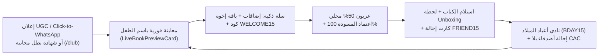

# Bubbleverse — استراتيجية تطوير الأعمال والتفوق التنافسي 2026
## Competitive Intelligence, Unit Economics & 90-Day Growth Master Playbook

**تاريخ الإعداد:** نوفمبر 2026 | **النطاق:** مصر (EGP) • السعودية (SAR) • الإمارات (AED)  
**المرجعية الميدانية:** فحص مباشر عبر المتصفح لـ 8 منافسين فعليين (4 رواد عالميين + 4 منافسين مباشرين في الشرق الأوسط وشمال أفريقيا)، ومطابقة كاملة مع قاعدة الكود الفعلية لـ Bubbleverse وخارطة التنفيذ (`CODEX_DIRECTIVES.md` و`docs/MVP_EXECUTION_PLAN_AR.md`).

> [!IMPORTANT]
> **الخلاصة التنفيذية (Executive Positioning):**
> الفجوة الذهبية (**White Space**) في سوق قصص الأطفال المخصصة لعام 2026 تقع بدقة بين طرفين مكسورين:
> 1. **العمالقة العالميون (Wonderbly / Hooray Heroes / Magic Story / LoveToRead):** تجربة شراء مذهلة ومعاينة فورية وهندسة AOV متقنة، لكنها بأسعار مرتفعة ($40–$100)، إنجليزية بالأساس، بلا دعم عربي/RTL أصيل، وبشحن دولي بطيء ومكلف للمنطقة.
> 2. **المنافسون الإقليميون (Kunhero / Qissati / Magical Hekaya / StoryHero):** يعانون إما من تجربة متجر بدائية وبطء شحن كارثي (20 يوم عمل في Kunhero)، أو تسعير انتحاري وكتالوج وهمي (Qissati)، أو حصر رقمي وبوابة تسجيل دخول قسرية وRTL مكسور (Magical Hekaya)، أو ثغرة خصوصية قاتلة وغياب كامل لبوابة B2B (StoryHero).
>
> **كيف تفوز Bubbleverse؟** بدمج **أفضل آليات التحويل العالمية** (معاينة حية فورية للغلاف والإهداء، منظومة إضافات عالية الهامش، نادي أعياد الميلاد، شهادة مجانية كـ Lead Magnet، وحلقة إحالة فيروسية) مع **التفوق المحلي والأخلاقي في MENA** (درع خصوصية 100% بلا استخدام إعلاني لصور الأطفال، عربون 50% عبر InstaPay/STC Pay/Apple Pay يحمي الطباعة المخصصة، تسليم 3–7 أيام، محرك إنتاج KDP 300 DPI، وبوابة مدارس وشركات B2B بلا تسجيل دخول).

---

## 1. مصفوفة المقارنة التنافسية الكاملة (8 Competitors vs. Bubbleverse)

### 1.1 الرواد العالميون وقادة الذكاء الاصطناعي (Global & AI Leaders vs. Bubbleverse)

| المعيار (Dimension) | Wonderbly (UK/Global) | Hooray Heroes (US/EU) | Magic Story (US) | LoveToRead.ai (US) | **Bubbleverse (EG/SA/AE)** |
|---|---|---|---|---|---|
| **الدعم والتموضع** | مدعوم من Penguin Random House؛ خطاب **Anti-AI** صريح (*"Created by artists, never AI"*) | مستقل ضخم؛ خطاب **Anti-AI**؛ عائلي وعاطفي | AI 3D بأسلوب Pixar؛ شراكات IP (مثل WWE) | منصة AI متعددة الأساليب (10 أنماط رسم) | **Artisan-Directed AI**؛ إشراف بشري + شيت ملامح موحد + طباعة فاخرة 8.5"×8.5" |
| **نطاق السعر** | $39.99 – $99.99 (Softcover / Jumbo / Hardcover / Layflat) | $39 – $69 + حزم هدايا ودمى | $44.99 للكتاب الواحد؛ اشتراك Magic Story+ بـ $24.99/شهر (-44%) | $14.99 رقمي -> $39.99 مطبوع؛ نسخة إضافية $34.99 | **مصر:** 250 PDF / 450–750 مطبوع (EGP) **الخليج:** 59 PDF / 99–165 مطبوع (SAR/AED) |
| **عمق التخصيص** | الاسم + أفاتار مرسوم يدوياً (ليس صورة حقيقية) | 1–3 أطفال + آباء/حيوانات + Hero Palette | تحويل صورة حقيقية إلى أفاتار 3D | حتى 3 شخصيات/حيوانات + 10 أساليب فنية | **صورة حقيقية للطفل** + بطل ثانٍ (Co-Hero) + مناسبة + إهداء + عربي/إنجليزي/ثنائي اللغة |
| **المعاينة قبل الشراء** | **الأقوى عالمياً:** Flipbook فوري 30 صفحة | معاينة فورية كاملة | معاينة أفاتار فورية | ضمان إعادة الرسم (*"Nothing prints until you approve"*) | **معاينة حية فورية للغلاف والإهداء** (قبل الطلب) + **اعتماد مسودة 100%** على واتساب قبل الطباعة |
| **خصوصية الصور** | لا يطلب صوراً حقيقية (إلا في إهداء الصورة الاختياري) | لا يطلب صوراً حقيقية | **شارة خصوصية واضحة:** (*"Your photo isn't stored; transformed, then gone"*) | سياسة قياسية | **درع خصوصية Zero-Retention 100%:** لا إعلانات، لا تدريب عام، حذف تلقائي بعد التسليم |
| **محرك رفع السلة (AOV)** | Micro-upsells (+$3 لون غلاف، +$9.99 صورة إهداء، +$12.99 علبة فاخرة) | خصم 20% لكتابين / 25% لـ3 كتب + Upgrade Popup + دمى | اشتراك شهري + تطبيق قصص صوتية مرافق | كود QR على الغلاف الخلفي يفتح Videobook مروي + نسخ إضافية | **5 إضافات عالية الهامش:** دفتر تلوين، علبة هدايا، 24 ستيكر، قصة صوتية QR، بطل ثانٍ + **خصم 15% (كتابين) / 25% (3+ كتب)** |
| **الاحتفاظ والنمو العضوي** | Birthday Club + إحالة Mention-Me (**Give 25% / Get 25%**) + عداد شحن عاجل | **+100 نشاط وتلوين مجاني** لجمع الإيميل وتاريخ الميلاد | اشتراك شهري متكرر | إهداء ونسخ إضافية | **شهادة بطل مجانية فورية (PNG)** + **نادي أعياد الميلاد (`BDAY15`)** + **إحالة واتساب (`FRIEND15`)** |
| **دعم العربية وMENA** | ضعيف/غير أصيل؛ شحن دولي مكلف | لا يوجد عربي/RTL | لا يوجد عربي/RTL | إنجليزي بالأساس | **أصيل 100% عربي RTL وإنجليزي LTR وثنائي اللغة** + دفع محلي (InstaPay / STC Pay / Apple Pay) |

---

### 1.2 المنافسون المباشرون في الشرق الأوسط وشمال أفريقيا (MENA Direct Competitors vs. Bubbleverse)

| المعيار (Dimension) | Kunhero (مصر) | Qissati (مصر) | Magical Hekaya (عالمي/MENA) | StoryHero (الإمارات — الأقوى إقليمياً) | **Bubbleverse (EG/SA/AE)** |
|---|---|---|---|---|---|
| **السوق والسعر** | مصر: 400 EGP | مصر: 150–180 EGP (تسعير غير مستدام) | عالمي بـ USD فقط: $6.99–$9.99 (+$4.99 فيديو) | الإمارات/الخليج: **149 AED (~$40)** | **مصر:** 450–750 EGP (250 PDF) **السعودية/الإمارات:** 99–165 SAR/AED (59 PDF) — أرخص 33% من StoryHero كنقطة دخول! |
| **المنتج والكتالوج** | ~10 قصص؛ WooCommerce بدائي | **5 قصص حقيقية فقط** رغم ادعاء +50! | رقمي PDF فقط (**لا توجد طباعة ورقية**) | **35 قصة ثقافية متقنة** (رمضان، الكعبة، الأذكار، اليوم الوطني، الشاشات) | كتالوج متنامٍ بمناسبات MENA (رمضان والعيد، التخرج، الإخوة، قيم النوم، المهن) + **عينة استوديو حقيقية (`zain-bubble-galaxy`)** |
| **تجربة الطلب والمعاينة** | يفرض رفع **4 صور**؛ **صفر معاينة** | ميزة جيدة: +30 EGP لطفل ثانٍ واختيار الصفات؛ **واتساب معطل (`+20 123 456 7890`)** | **يفرض تسجيل Clerk قبل الخطوة 1**؛ RTL مكسور (`dir="ltr"`) | معاينة عبر مصمم بشري على واتساب (انتظار أيام قبل الرؤية) | **صفر تسجيل دخول إجباري**؛ معاينة حية فورية للغلاف والإهداء + RTL مثالي + اعتماد مسودة قبل الطباعة |
| **مدة التسليم** | **20 يوم عمل** (10 تجهيز + 10 شحن!) | غير منضبطة | فوري (رقمي فقط) | جيد محلياً في الإمارات | **رقمي: 1–2 يوم** • **مصر: 3–5 أيام** • **الإمارات: 4–6 أيام** • **السعودية: 5–7 أيام** (أسرع 4× من Kunhero!) |
| **الدفع ومخاطر COD** | **COD فقط** (مخاطرة مرتجع قاتلة) | تحويل/COD عشوائي | بطاقة دولية USD فقط | COD + بطاقات (لكن رد فعلهم على رفض COD كارثي!) | **عربون 50% يحمي الطباعة المخصصة** (InstaPay / Vodafone Cash / STC Pay / Mada / Apple Pay) + Tabby/Tamara Ready |
| **منظومة AOV والإضافات** | **لا يوجد** (لا تغليف هدايا ولا إضافات) | طفل ثانٍ فقط (+30 EGP) | فيديو/ريل (+$4.99) + سرد صوتي | **الأقوى في MENA:** ستيكرز +75، تلوين +90، بازل +65، بورتريه +105، فيديو 20ث +240 AED + باقات | **منظومة إضافات متكاملة بسعر ذكي:** تلوين، علبة هدايا، 24 ستيكر، قصة صوتية QR، بطل ثانٍ + **1-Click Cart Upsell** + **وضع الهدايا (إخفاء السعر)** |
| **نقطة الضعف القاتلة (Fatal Flaw)** | بطء 20 يوم + صفر معاينة + نزيف COD | هوامش ميتة + كتالوج مضلل + واتساب مكسور | بلا طباعة + تسجيل قسري + عربي مكسور | **ثغرة أخلاقية وتجارية فادحة:** سياستهم تحتفظ بحق استخدام كتب الأطفال المرفوضة في COD داخل إعلاناتهم! + **لا توجد بوابة B2B** | **لا توجد ثغرة خصوصية**؛ التحدي الوحيد المطلوب ضبطه مبكراً هو تشغيل المطبعة المحلية في الخليج عند تخطي 30–50 كتاب/شهر |
| **بوابة B2B (مدارس/شركات)** | لا توجد | لا توجد | لا توجد | **لا توجد** | **بوابة `/schools` مفتوحة بلا تسجيل دخول** بحاسبة أسعار فورية (20–500+ كتاب) لقطاعي المدارس والموارد البشرية HR |

### الدروس التكتيكية المستخلصة من الفحص المباشر
1. **من Wonderbly & Hooray Heroes:** العميل يشتري بعينيه قبل بطاقته — **المعاينة الحية الفورية + المغناطيس المجاني (Free Printable) + خصومات الإخوة** هي المحركات الثلاثة التي تخفض CAC وترفع معدل التحويل (+35–60%).
2. **من Magic Story & LoveToRead:** القلق من الذكاء الاصطناعي يُعالج بـ **شارة خصوصية صريحة تحت خانة رفع الصورة** + **ضمان اعتماد كل صفحة قبل الطباعة** + **كود QR صوتي** يربط الكتاب الورقي بالتجربة الرقمية بتكلفة هامشية شبه صفرية.
3. **من StoryHero (المنافس الأخطر في الخليج):** نجحوا بسبب **العناوين الثقافية العربية** و**رفع السلة (AOV Ecosystem)**؛ ونستطيع هزيمتهم مباشرةً عبر **سعر دخول أذكى بـ33% (99 مقابل 149 AED)**، و**درع خصوصية أخلاقي يضرب سياستهم في مقتل**، و**احتكار سوق المدارس والشركات B2B** قبل أن يلتفتوا إليه.

---

## 2. العيوب العشرة الحقيقية في السوق والعمل — والحلول الهندسية والتجارية

هذه ليست افتراضات نظرية؛ بل **أخطر 10 فخاخ تشغيلية وتجارية** تواجه أي مشروع قصص مخصصة في مصر والخليج، مع الحل الهندسي والتجاري المدمج في Bubbleverse لكل منها:

| # | العيب / الخطر الحقيقي (Market or Business Defect) | الأثر المالي والتشغيلي إذا أُهمل | الحل الهندسي والتجاري المعتمد في Bubbleverse (Engineered Countermeasure) |
|---|---|---|---|
| **1** | **خطر رفض الدفع عند الاستلام للكتب المخصصة (COD Refusal / Dead Inventory Trap)** | الكتاب المطبوع باسم وصورة "زين" **لا يمكن إعادة بيعه أبداً**. رفض 15–25% من طلبات COD في مصر/الخليج يمحو صافي ربح الشركة بالكامل (ودفع StoryHero لسياسة إعلانية سيئة السمعة!). | **عربون 50% إلزامي قبل الطباعة** عبر أسرع وسائل الدفع المحلية (`InstaPay` / `Vodafone Cash` في مصر، `STC Pay` / `Mada` في السعودية، `Apple Pay` / البطاقات في الإمارات + جاهزية `Tabby/Tamara`) + **بوابة اعتماد المسودة (`draft_ready -> sent_to_print`)** التي تمنع الطباعة قبل موافقة ولي الأمر كتابياً على واتساب. |
| **2** | **ذعر أولياء الأمور على خصوصية صور الأطفال (Parent Photo Privacy Fear)** | تردد الأمهات (خصوصاً في السعودية والإمارات) في رفع صورة طفلهن لمتجر جديد يسبب تسرب 30–50% من زوار صفحة المنتج، خاصة مع قصص تسريب بيانات AI وسياسات منافسين تبيح استخدام الصور إعلانياً. | **درع الخصوصية الصفري (Zero-Retention Privacy Shield):** 4 تعهدات صريحة مرئية في الرئيسية وتحت مربع الرفع مباشرة في صفحة المنتج (لا إعلانات، لا تدريب عام، حذف تلقائي بعد التسليم أو فور الطلب، معاينة كاملة قبل الطباعة) + نماذج عرض اصطناعية فقط (`zain-bubble-galaxy`) + تخزين خاص معزول (`photoVault` حالياً، ثم `CX-004` للتحقق الخادمي وإزالة EXIF وروابط مؤقتة خاصة). |
| **3** | **قلق الشراء الأعمى وغياب المعاينة الفورية (Blind Checkout & Preview Anxiety)** | طلب الدفع أو الانتظار 3–10 أيام قبل رؤية أي شيء (مثل Kunhero وStoryHero) يقتل الشراء الاندفاعي (Impulse Gifting) ويضاعف تكلفة الاستحواذ. | **قمع ثقة من مرحلتين (Two-Stage Confidence Funnel):** (1) **معاينة تفاعلية فورية (`LiveBookPreviewCard`)** تُحدث الغلاف 3D وصفحة الإهداء لحظياً باسم الطفل وصورته والبطل الثاني والمناسبة دون أي تسجيل دخول؛ (2) **ضمان مراجعة المسودة الكاملة 100%** قبل دخول المطبعة. |
| **4** | **انضغاط الهوامش في مصر مقابل الخليج (Egypt EGP Margin Compression vs. GCC)** | التسعير الرخيص في مصر (150–400 EGP) يترك هامشاً لا يغطي ارتفاع تكلفة إعلانات Meta وتكلفة الطباعة الفاخرة؛ بينما الخليج يدفع 2.5× إلى 4× بنفس تكلفة الإنتاج الذهني والبرمجي تقريباً. | **استراتيجية المحركين (Dual-Engine Market Architecture):** استخدام **مصر** كمختبر سرعة ومحتوى UGC وحجم مبيعات B2B للمدارس مع رفع سلة المستهلك إلى 650–900 EGP عبر الإضافات؛ واستخدام **السعودية والإمارات** كمحرك صافي الربح الرئيسي (99–165 SAR/AED أساسي -> 170–230 SAR/AED بالإضافات) مع تسعير موحد متعدد العملات (`pricingEngine.ts`). |
| **5** | **فخ تكلفة الاستحواذ على كتاب واحد (Single-Book CAC Trap)** | شراء زائر من Meta/TikTok بـ 130 EGP (مصر) أو 32–34 SAR/AED (الخليج) لبيع كتاب واحد فقط يضغط صافي الهامش إلى 16–19% ويبطئ دورة التدفق النقدي. | **مضاعف السلة والقيمة الدائمة (3-Layer AOV & LTV Multiplier):** (أ) 5 إضافات عالية الهامش (71%–91% هامش إجمالي) في PDP و1-Click داخل السلة؛ (ب) خصم الإخوة التدرجي (**كتابين -15% + شحن مجاني، 3+ كتب -25%**) مع شريط تقدم تحفيزي؛ (ج) **نادي أعياد الميلاد + شهادة البطل المجانية + إحالة `FRIEND15`** لتوليد طلبات بتكلفة استحواذ صفرية. |
| **6** | **وصمة "كتب الذكاء الاصطناعي الرخيصة" وتشوه الملامح (AI Stigma & Consistency Failure)** | استغلال Wonderbly وHooray Heroes لأخطاء كتب الـAI الرديئة (تغير ملامح الطفل من صفحة لأخرى، أخطاء الخط العربي، دقة طباعة ضعيفة) لتنفير الأهل. | **استوديو الإنتاج المتقن (Stage 2 Character-Sheet Workflow):** تسويق القصة كـ *"إصدار فني مصمم بملامح طفلك وبإشراف بشري"* لا "توليد تلقائي أعمى"، مدعوماً بشيت هوية الشخصية الموحد (`stage2PromptEngine.ts`)، وفاحص دقة **300 DPI** التلقائي (`>=2500px`)، ومعرض صفحات حقيقية منتَجة من نفس المحرك (`zain-bubble-galaxy`). |
| **7** | **صدمات المواسم واختناق القدرة الإنتاجية (Seasonal Spikes: Ramadan, Eid, Graduations)** | تتركز 45–60% من مبيعات الهدايا في رمضان/العيد وموسم تخرج الحضانات (مايو–يونيو) وأعياد الميلاد؛ التأخر يوماً واحداً بعد العيد يعني إلغاءً واسترداداً. | **توازن الكتالوج + حجز مبكر + صمام أمان رقمي:** وسوم مناسبات دائمة وموسمية (`occasions`) + **حاسبة موعد التسليم الفورية** (`estimateDeliveryWindow`) التي تضبط توقعات العميل بوضوح + حملات حجز مبكر بخصم `EID20` قبل الموسم بـ3 أسابيع + **خيار النسخة الرقمية PDF (1–2 يوم)** كإنقاذ فوري في آخر 72 ساعة قبل أي مناسبة. |
| **8** | **عنق الزجاجة التشغيلي في واتساب وتجهيز الطباعة (WhatsApp & Print Prep Bottleneck)** | عند تجاوز 10 طلبات يومياً، ينهار العمل اليدوي بين مطاردة صور مشوشة، ونسخ برومبتات، وبناء ملفات PDF للطباعة يدوياً (3–4 ساعات للكتاب الواحد). | **مسرّع العمليات الإدارية (Admin Production Pipeline):** ربط كامل بين `AdminOrders` (شريط تقدم المسودة `X/Y • A/6` وأزرار واتساب بضغطة واحدة لطلب صورة أوضح أو إرسال المسودة) -> `AdminStudio` (قائمة 6 خطوات + حزمة برومبتات `.txt` + رفع جماعي) -> `AdminPdfBuilder` (تصدير PDF طباعي `8.5"×8.5"` بدقة 300 DPI بضغطة واحدة). يخفض وقت التجهيز إلى **35–45 دقيقة للكتاب**. |
| **9** | **حاجز تسجيل الدخول القسري وسوء تجربة الموبايل العربي (Forced Auth & Broken RTL)** | فرض تسجيل حساب قبل التخصيص (مثل Magical Hekaya) أو كسر اتجاه RTL يسبب ارتداد 60%+ من زيارات إعلانات إنستغرام وتيك توك على الهاتف. | **تجارة ضيوف بلا تسجيل دخول (`Guest-First UX`):** تصفح -> معاينة حية -> سلة -> إتمام طلب كضيف -> حاسبة مدارس B2B -> استوديو شهادة البطل المجانية، كلها تعمل **بصفر تسجيل دخول** وبأزرار لمس ≥44px وعربية RTL أصلية. |
| **10** | **هشاشة الشحن العابر للحدود وتكلفة الشحن الفردي للخليج (Cross-Border Shipping Margin Killer)** | شحن كتاب واحد مطبوع من القاهرة إلى الرياض أو دبي عبر DHL/Aramex يكلف 65–110 SAR للكتاب الواحد، ما يلتهم كامل هامش البيع ويسبب تأخيرات جمركية. | **معمارية الطباعة المحلية المرحلية (Localized POD Hub):** (1) **مصر:** طباعة محلية في القاهرة + شحن 3–5 أيام (~55–75 EGP)؛ (2) **الخليج المرحلة الأولى:** البدء بالنسخة الرقمية PDF (`59 SAR/AED` بهامش ~78%) + الحزم العالية (`>=200 SAR/AED`) أو التجميع الأسبوعي؛ (3) **الخليج المرحلة الثانية (عند 30–50 كتاب/شهر):** تفعيل مطبعة ديجيتال شريكة في الرياض ودبي لخفض تكلفة الطباعة+الشحن المحلي إلى ~30–40 SAR/AED وتسليم خلال 4–6 أيام. |

---

## 3. اقتصاديات الوحدة ومخطط التسعير متعدد الأسواق (Unit Economics & Pricing Blueprint)

> [!NOTE]
> **ملاحظة حوكمة مالية (Financial Honesty per `docs/MVP_EXECUTION_PLAN_AR.md`):**
> أسعار البيع والإضافات والخصومات في الجداول أدناه **مطابقة 100% للكود الفعلي** في `catalogStories.ts` و`pricingEngine.ts`. أما تقديرات التكلفة المباشرة (COGS) وتكلفة الاستحواذ (CAC) فهي **افتراضات تخطيطية مستهدفة (Planning Benchmarks)** تُقاس وتُحدّث بالأرقام الفعلية خلال التجربة المغلقة (`M3–M8`) وعروض المطابع المحلية قبل إطلاق الإعلانات الممولة على نطاق واسع.

### 3.1 جدول التسعير الموحد متعدد الأسواق (Multi-Market Pricing Matrix)

| المنتج / الإضافة (SKU / Add-on) | مصر (EGP) | السعودية (SAR) | الإمارات (AED) | التكلفة المباشرة المقدرة (Est. COGS) | الهامش الإجمالي (Est. GM%) |
|---|---|---|---|---|---|
| **نسخة رقمية PDF فاخرة (15–25 صفحة)** | 250 | 59 | 59 | 75 EGP / 13 SAR / 13 AED | **70% (EG) • 78% (GCC)** |
| **غلاف مقوى فاخر 15 صفحة (8.5"×8.5")** | 450–500 | 99–110 | 99–110 | 240 EGP / 48 SAR / 49 AED | **47%–52%** |
| **غلاف مقوى فاخر 25 صفحة (8.5"×8.5")** | 700–750 | 159–165 | 159–165 | 305 EGP / 62 SAR / 63 AED | **56%–62%** |
| **+ إضافة: دفتر تلوين الأبطال المطابق** | +75 | +19 | +19 | 20 EGP / 5 SAR / 5 AED | **~73%** |
| **+ إضافة: علبة هدايا فاخرة + كارت إهداء** | +95 | +25 | +25 | 28 EGP / 7 SAR / 7 AED | **~71%** |
| **+ إضافة: شيت 24 ستيكر بشخصية الطفل** | +65 | +18 | +18 | 12 EGP / 3 SAR / 3 AED | **~82%** |
| **+ إضافة: قصة صوتية مروية بكود QR** | +110 | +29 | +29 | 10 EGP / 2 SAR / 2 AED | **~91%** |
| **+ إضافة: بطل ثانٍ Co-Hero (أخ/أخت/صديق)** | +80 | +20 | +20 | 15 EGP / 3 SAR / 3 AED | **~81%** |

**قواعد خصومات الكمية (`getVolumeDiscountTier`):**
- **كتاب واحد:** 0% خصم (الشحن على العميل).
- **كتابان (باقة الإخوة/الهدايا):** **خصم 15% + شحن مجاني**.
- **3 كتب فأكثر:** **خصم 25% + شحن مجاني**.

---

### 3.2 إثبات أثر الإضافات وباقات الإخوة على صافي الهامش (+45% إلى +160% قفزة في هامش الربح الصافي!)

تفترض المقارنة نفس تكلفة الاستحواذ الإعلانية (Paid CAC) للطلب الواحد: `130 EGP` في مصر، `32 SAR` في السعودية، و`34 AED` في الإمارات (مع تفعيل الطباعة المحلية في الخليج).

#### أ) سوق مصر (EGP — محرك الحجم والـUGC والمدارس)

| السيناريو (Scenario) | الإيراد الصافي (AOV) | التكلفة المباشرة (COGS + شحن ممتص) | الهامش الإجمالي (Gross Profit) | تكلفة الاستحواذ (CAC) | **صافي الربح (Net Profit)** | **صافي الهامش % (Net Margin)** | **نسبة القفزة مقابل كتاب مفرد** |
|---|---|---|---|---|---|---|---|
| **1. كتاب 15ص مفرد (Baseline)** | 450 EGP | 240 EGP | 210 EGP (46.7%) | 130 EGP | **80 EGP** | **17.8%** | خط الأساس (1.0×) |
| **2. كتاب 15ص + علبة هدايا + بطل ثانٍ (محافظ)** | 625 EGP | 287 EGP | 338 EGP (54.1%) | 130 EGP | **208 EGP** | **33.3%** | **+87% في نسبة الهامش** (+160% صافي ربح) |
| **3. كتاب 15ص + علبة + تلوين + QR صوتي (مثالي)** | 730 EGP | 304 EGP | 426 EGP (58.4%) | 130 EGP | **296 EGP** | **40.5%** | **+128% في نسبة الهامش** (+270% صافي ربح) |
| **4. باقة إخوة: كتابان (-15%) + علبة + ستيكرز** | 901 EGP | 548 EGP* | 353 EGP (39.2%) | 130 EGP | **223 EGP** | **24.8%** | **+39% في نسبة الهامش** (+179% صافي ربح) |

*\*تشمل امتصاص 60 EGP شحن مجاني.*

#### ب) سوق السعودية (SAR — محرك الربحية الأعلى نمواً)

| السيناريو (Scenario) | الإيراد الصافي (AOV) | التكلفة المباشرة (COGS + شحن ممتص) | الهامش الإجمالي (Gross Profit) | تكلفة الاستحواذ (CAC) | **صافي الربح (Net Profit)** | **صافي الهامش % (Net Margin)** | **نسبة القفزة مقابل كتاب مفرد** |
|---|---|---|---|---|---|---|---|
| **1. كتاب 15ص مفرد (Baseline)** | 99 SAR | 48 SAR | 51 SAR (51.5%) | 32 SAR | **19 SAR** | **19.2%** | خط الأساس (1.0×) |
| **2. كتاب 15ص + علبة + تلوين + QR صوتي** | 172 SAR | 64 SAR | 108 SAR (62.8%) | 32 SAR | **76 SAR** | **44.2%** | **+130% في نسبة الهامش** (+300% صافي ربح) |
| **3. باقة إخوة: كتابان (-15%) + علبة + ستيكرز** | 205 SAR | 122 SAR* | 83 SAR (40.5%) | 32 SAR | **51 SAR** | **24.9%** | **+30% في نسبة الهامش** (+168% صافي ربح) |
| **4. كتاب 25ص فاخر + علبة + بطل ثانٍ** | 204 SAR | 74 SAR | 130 SAR (63.7%) | 32 SAR | **98 SAR** | **48.0%** | **+150% في نسبة الهامش** (+416% صافي ربح) |

*\*تشمل امتصاص 22 SAR شحن مجاني محلي.*

#### ج) سوق الإمارات (AED — ساحة المنافسة المباشرة مع StoryHero)

| السيناريو (Scenario) | الإيراد الصافي (AOV) | التكلفة المباشرة (COGS) | الهامش الإجمالي | تكلفة الاستحواذ (CAC) | **صافي الربح (Net Profit)** | **صافي الهامش % (Net Margin)** | **التموضع أمام StoryHero (149 AED)** |
|---|---|---|---|---|---|---|---|
| **1. كتاب 15ص مفرد (Baseline)** | 99 AED | 49 AED | 50 AED (50.5%) | 34 AED | **16 AED** | **16.2%** | أرخص بـ 33% كسعر دخول |
| **2. كتاب 15ص + علبة + تلوين + QR صوتي** | 172 AED | 65 AED | 107 AED (62.2%) | 34 AED | **73 AED** | **42.4%** | **+162% في نسبة الهامش** (+356% صافي ربح)؛ قيمة مضاعفة بنفس نطاق سعر المنافس |
| **3. كتاب 25ص + علبة + بطل ثانٍ** | 204 AED | 74 AED | 130 AED (63.7%) | 34 AED | **96 AED** | **47.1%** | أعلى ربحية وأسرع معاينة + درع خصوصية يتفوق أخلاقياً |

> **الخلاصة الاقتصادية:** إضافة **مادتين فقط** (مثل علبة الهدايا + دفتر التلوين أو البطل الثاني) ترفع صافي الهامش بأكثر من **+87% إلى +162%** وتضاعف صافي الربح النقدي للطلب **2.6× إلى 4.5×** دون دفع قرش واحد إضافي في إعلانات Meta/TikTok!

---

### 3.3 اقتصاديات قطاع المدارس والشركات (`B2B Bulk Pricing` — `calculateB2BBulkQuote`)

| شريحة الكمية (Tier) | نسبة الخصم | سعر الكتاب المطبوع (مصر EGP) | سعر الكتاب المطبوع (السعودية/الإمارات SAR/AED) | سعر PDF الرقمي (EG / GCC) | لماذا تكون الربحية الصافية استثنائية في B2B؟ |
|---|---|---|---|---|---|
| **20–49 طفلاً** (حضانة صغيرة) | **-20%** | 360 EGP | 79 SAR/AED | 160 EGP / 39 GCC | صفقة واحدة = إيراد 10,000+ EGP أو 2,300+ SAR بـ CAC شبه صفري. |
| **50–99 طفلاً** (تخرج KG) | **-32%** | 306 EGP | 67 SAR/AED | 136 EGP / 33 GCC | الطباعة الدفعية تخفض تكلفة النسخة 30%+ وتوحيد القالب يختصر زمن التصميم. |
| **100–249 طفلاً** (مدرسة/شركة متوسطة) | **-42%** | 261 EGP | 57 SAR/AED | 116 EGP / 28 GCC | **مثال 100 كتاب (مصر):** 26,100 إيراد - ~12,000 تكلفة مجمعة = **~14,100 EGP صافي ربح من عميل واحد!** |
| **250+ طفلاً** (مؤسسة/بنك/مجموعة مدارس) | **-52%** | 216 EGP | 48 SAR/AED | 96 EGP / 24 GCC | **مثال 250 كتاب (خليج):** 12,000 SAR إيراد - ~5,500 تكلفة مجمعة = **~6,500 SAR صافي ربح + 250 عائلة جديدة تتحول لعملاء B2C مجاناً!** |

---

## 4. خطة النمو والانطلاق للسوق خلال 90 يوماً (90-Day Growth & GTM Playbook)

### المرحلة 1: الأيام 1–30 — إثبات المنتج، المحتوى الفيروسي، وتوليد العملاء بتكلفة منخفضة
1. **عجلة محتوى فتح الصندوق (UGC Unboxing Flywheel):**
   - إرسال **15–20 كتاباً مجانياً** لأمهات مؤثرات متوسطات/صغيرات (**Micro-Moms: 10K–80K متابع**) في القاهرة والإسكندرية والرياض وجدة ودبي (10 مصر + 5 السعودية + 5 الإمارات).
   - الشرط الإبداعي الوحيد: تصوير **لحظة رؤية الطفل لنفسه داخل الكتاب للمرة الأولى** (Reaction Shot في أول 3 ثوانٍ) + إظهار جودة الطباعة `8.5"×8.5"` وعلبة الهدايا.
   - تحويل أفضل 5 فيديوهات UGC إلى إعلانات ممولة (Spark Ads على TikTok وReels Ads على Instagram)؛ لأن فيديو رد فعل الطفل يخفض تكلفة الشراء بنسبة 35–50% مقارنة بالإعلانات الثابتة.
2. **إعلانات Click-to-WhatsApp (CTWA) الموجهة للأمهات:**
   - استهداف الأمهات (25–42 سنة) ذوات اهتمامات: *الهدايا المخصصة، الحضانات الدولية، تعليم الأطفال، أعياد الميلاد*.
   - **زوايا الرسائل الإعلانية (3 Hooks مجرّبة):**
     * *الزاوية العاطفية:* "شفت فرحة ابنك لما يفتح كتاب ويلاقي نفسه البطل على كل صفحة؟"
     * *زاوية الخصوصية (ضد StoryHero):* "صورة طفلك أمانة — بنرسمله قصته، بتراجع كل صفحة قبل الطباعة، وبنحذف الصورة تماماً بعد الاستلام."
     * *زاوية السرعة (ضد Kunhero):* "ليه تستنى 20 يوم؟ معاينة فورية للغلاف دلوقتي وتسليم في 3–5 أيام!"
   - تقديم كود الترحيب `WELCOME15` داخل المحادثة وعلى الموقع لإغلاق أول طلب.
3. **مغناطيس العملاء المجاني — «شهادة بطل بابل فيرس» (`/club`):**
   - حملة خفيفة منخفضة التكلفة: *"صمّم ونزّل شهادة بطل باسم طفلك مجاناً في 10 ثوانٍ!"*.
   - تلتقط اسم الأم + واتساب + اسم الطفل + **تاريخ ميلاده** (تُحفظ فوراً في `AdminGrowth` Tab 3) -> تكلفة العميل المحتمل (CPL) تقل 70–80% عن إعلان الشراء المباشر، وتُحوَّل الأمهات تلقائياً إلى `/stories` بخصم فوري.

### المرحلة 2: الأيام 31–60 — مضاعفة السلة (AOV) وأتمتة الاحتفاظ والإحالة الفيروسية
1. **أتمتة نادي أعياد الميلاد (`Birthday Club Automation`):**
   - مراجعة أسبوعية لتبويب **«نادي أعياد الميلاد»** في `/admin/growth` لكل طفل يتبقى على عيد ميلاده **21 يوماً**.
   - بضغطة واحدة عبر زر **Send Birthday Offer on WhatsApp**: *"كل سنة و[اسم الطفل] بخير مقدماً! 🎉 فاضل 3 أسابيع على عيد ميلاده — جهزنا لك كود `BDAY15` لخصم 15% على قصته المخصصة عشان تلحق توصل قبل الحفلة!"*
2. **حلقة الإحالة الفيروسية (`Give 15%, Get 15%` — `FRIEND15`):**
   - نقطتا تفعيل ذهبيتان:
     * **لحظة إتمام الطلب:** بطاقة مشاركة كود `FRIEND15` مباشرة على شاشة الإيصال في `GuestCheckoutModal`.
     * **بعد 24 ساعة من التسليم (ذروة السعادة):** رسالة واتساب تطلب رأي الأم في الكتاب + رابط مشاركة `FRIEND15` لجروب أمهات الحضانة/العائلة.
3. **هندسة رفع السلة (CRO & Attachment Optimization):**
   - مراقبة مؤشر **معدل إرفاق الإضافات (Add-on Attachment Rate)** أسبوعياً من لوحة `/admin/growth` بهدف الوصول إلى **≥40%** (علبة هدايا / دفتر تلوين / 24 ستيكر / QR صوتي / بطل ثانٍ).
   - حملة إعادة استهداف (Retargeting) لزوار صفحة القصة بزاوية **«باقة الإخوة: كتابين بخصم 15% + شحن مجاني»**.
4. **مضاعفة المواسم بالكتالوج المخصص:**
   - قبل رمضان بـ3 أسابيع: ترويج **`ramadan-lantern-moon`** + كود `EID20`.
   - على مدار العام: ترويج **`zain-bubble-galaxy`** (إثبات جودة حقيقي) و**`sibling-super-team`** (رفع قيمة السلة التلقائي).

### المرحلة 3: الأيام 61–90 — هجوم B2B (المدارس والشركات) وتوطين مطبعة الخليج
1. **اختراق قطاع الحضانات والمدارس الدولية (Nurseries & Schools Graduation):**
   - قائمة مستهدفة من **100 حضانة ومدرسة دولية** في القاهرة الجديدة والشيخ زايد والرياض وجدة ودبي (خاصة قبل حفلات التخرج ونهاية العام).
   - العرض القاتل عبر `/schools`: **غلاف يحمل شعار المدرسة + قصة `little-graduate-star` مخصصة لكل طفل + خصم 32%–42% (50–250 طفلاً)** + كتاب عينة مطبوع مجاني لمديرة الحضانة.
   - إدارة كل عروض الأسعار والمتابعة عبر واتساب من تبويب **B2B Quotes CRM** في `/admin/growth`.
2. **اختراق هدايا الموارد البشرية للشركات (Corporate HR Voucher Gifting):**
   - استهداف إدارات الـHR والـPeople Experience في شركات التقنية والبنوك والاتصالات لمناسبات (العيد، رمضان، Family Day).
   - **الميزة التنافسية الفريدة:** الشركة تدفع الفاتورة المجمعة مرة واحدة، ثم يحصل كل موظف على كود/رابط استرداد خاص يرفع منه بيانات وصورة طفله بنفسه — **صفر عبء إداري أو مخاطرة خصوصية على قسم الـHR!**
3. **توطين الطباعة في الخليج (GCC Local Press Unlock):**
   - عند تثبيت طلبات الخليج فوق 30–50 كتاباً مطبوعاً شهرياً، توقيع اتفاقية طباعة عند الطلب مع مطبعة ديجيتال في الرياض/دبي لتثبيت مدة التسليم (4–6 أيام) وتأمين هامش صافي 42%–48%.

### لوحة مؤشرات النجاح لـ 90 يوماً (90-Day North Star KPIs)

| المؤشر (KPI) | الهدف — اليوم 30 (إثبات) | الهدف — اليوم 60 (نمو وكفاءة) | الهدف — اليوم 90 (توسع B2C + B2B) |
|---|---|---|---|
| **متوسط قيمة السلة — مصر (EG AOV)** | 560 EGP | 680 EGP | **750+ EGP** |
| **متوسط قيمة السلة — الخليج (GCC AOV)** | 135 SAR/AED | 165 SAR/AED | **185+ SAR/AED** |
| **معدل إرفاق الإضافات (Add-on Attachment)** | ≥ 25% | ≥ 40% | **≥ 50%** |
| **نسبة طلبات كتابين فأكثر (Multi-Book %)** | ≥ 15% | ≥ 25% | **≥ 30%** |
| **مشتركو الشهادة المجانية ونادي الميلاد** | 300+ ولي أمر | 1,200+ ولي أمر | **3,000+ ولي أمر** |
| **نسبة الطلبات من الإحالة والنادي (Zero-CAC %)** | 5% | 15% | **25%+** |
| **صفقات المدارس والشركات المغلقة (B2B Won)** | 1 تجربة (25–50 كتاباً) | 3–5 حضانات/شركات | **8–12 صفقة (500–1,000+ كتاب)** |
| **زمن تجهيز الكتاب في الاستوديو** | ≤ 60 دقيقة | ≤ 45 دقيقة | **≤ 35 دقيقة** |

---

## 5. خريطة ربط كل مبادرة استراتيجية بقاعدة الكود الفعلية (Strategy-to-Codebase Traceability Matrix)

كل مبادرة في هذه الاستراتيجية ليست مجرد حبر على ورق؛ بل مربوطة مباشرة بملفات ومكونات فعلية تم بناؤها أو يجري إتمامها والتحقق منها داخل هذا السرب، مع تفريق أمين وواضح بين **المتاح الآن على الواجهة/التخزين المحلي** و**المراحل الخلفية المجدولة في `CODEX_DIRECTIVES.md`**.

| المبادرة الاستراتيجية | المنافس المُستهدَف / العيب المُعالَج | الملفات والمسارات الفعلية في الكود | المالك في السرب | الحالة التنفيذية الدقيقة |
|---|---|---|---|---|
| **1. محرك التسعير متعدد العملات (EGP/SAR/AED) وخصومات الإخوة (15%/25%) وموعد التسليم وحاسبة B2B** | انضغاط هوامش مصر، بطء 20 يوم (Kunhero)، فخ الكتاب الواحد | `src/features/commerce/pricingEngine.ts` `scripts/commerce-engine.test.mjs` | `@pricing-engine` | طبقة منطق نقي + اختبارات Node وحدوية (يلحقها تسعير خادمي إلزامي في `CX-007`) |
| **2. طبقة حفظ السلة وأكواد الخصم (`WELCOME15`, `EID20`, `BDAY15`, `FRIEND15`) وعملاء B2B ونادي الميلاد** | غياب الاحتفاظ والتكرار، تعدد العملات | `src/types/cart.ts` `src/contexts/cartState.ts` `src/contexts/CartContext.tsx` `src/lib/localStore.ts` | `@growth-store` | حفظ محلي فوري متوافق مع الواجهة (يُرحّل إلى جداول Supabase في `CX-007`) |
| **3. كتالوج مناسبات MENA + عينة الاستوديو الحقيقية (`zain-bubble-galaxy`) + رمضان والإخوة والتخرج** | تفوق StoryHero الثقافي، كتالوج Qissati الوهمي، وصمة الـAI | `src/features/stories/catalogStories.ts` `public/showcase/zain-sample/*` | `@catalog-curator` | أصول حقيقية محلية مُتحقَّق منها + وسوم `occasions` و`supportsCoHero` وأسعار AED |
| **4. المعاينة الحية الفورية للغلاف 3D وصفحة الإهداء باسم وصورة الطفل** | الشراء الأعمى (Kunhero/StoryHero)؛ محاكاة تفوق Wonderbly | `src/components/product/LiveBookPreviewCard.tsx` | `@live-preview` | مكون تفاعلي فوري على المتصفح يدعم RTL/LTR و`useReducedMotion` |
| **5. درع الخصوصية الصفري (Zero-Retention Shield) + الأسئلة الشائعة المعالجة لـ6 اعتراضات شراء** | فضيحة إعلانات COD في StoryHero، خوف الأمهات على الصور | `src/components/showcase/PrivacyAndFaqSection.tsx` | `@trust-privacy` | مدمج في الصفحة الرئيسية؛ تقوية الرفع الخادمي وإزالة EXIF والحذف التلقائي في `CX-004` |
| **6. نادي أعياد الميلاد + إحالة واتساب `FRIEND15` + استوديو شهادة البطل المجانية (PNG فوري)** | غياب الـLead Magnet والاحتفاظ (محاكاة Hooray Heroes & Wonderbly) | `src/components/growth/GrowthRetentionSection.tsx` `src/pages/GiftClub.tsx` (المسار `/club`) | `@growth-hub` | شهادة PNG مولّدة 100% على Canvas بلا تسجيل دخول + حفظ فوري للعملاء |
| **7. بوابة المدارس والحضانات وهدايا الشركات B2B بلا تسجيل دخول + حاسبة فورية** | احتكار قناة B2B الغائبة عند جميع منافسي MENA الأربعة | `src/pages/SchoolsPortal.tsx` (المسار `/schools`) | `@b2b-portal` | حاسبة 20–500+ كتاب (EG/SA/AE) + حفظ فوري في Admin CRM + رسالة واتساب جاهزة |
| **8. صفحة المنتج المحسّنة للتحويل (AOV Add-ons + Co-Hero + Delivery Estimator + Privacy Micro-Badge)** | فخ الكتاب الواحد، قلق الخصوصية وموعد التسليم | `src/pages/ProductDetail.tsx` (`/products/:slug`) | `@pdp-optimizer` | يدمج المعاينة الحية و5 إضافات عالية الهامش وتقدير التسليم وشارة الخصوصية |
| **9. السلة الذكية وCheckout ثلاثي الدول (EG/SA/AE) + 1-Click Upsell + وضع الهدايا + كارت الإحالة** | مخاطر COD (عربون 50%)، تسرب السلة، توسع الإمارات والسعودية | `src/components/cart/CartDrawer.tsx` `src/components/cart/GuestCheckoutModal.tsx` | `@cart-checkout` | شريط خصم الإخوة + أكواد الخصم + إخفاء سعر الهدية + إحالة بعد الطلب (بوابات الدفع الحية في `CX-007`) |
| **10. دمج قمع الصفحة الرئيسية وفلاتر المناسبات في الكتالوج والتنقل النظيف** | سهولة الاكتشاف حسب المناسبة + تجربة موبايل RTL سلسة | `src/pages/Index.tsx`, `src/pages/Stories.tsx` `src/components/Header.tsx`, `src/components/Footer.tsx`, `src/App.tsx` | `@catalog-home` | ربط `/schools` و`/club` و`/admin/growth` وفلاتر المناسبات وبانر توفير الإخوة |
| **11. مركز قيادة النمو والعروض وB2B CRM في لوحة الإدارة** | غياب متابعة الأكواد، عروض المدارس، ومواعيد أعياد الميلاد | `src/pages/admin/AdminGrowth.tsx` (`/admin/growth`) `src/components/admin/AdminSidebar.tsx` `src/pages/admin/AdminOverview.tsx` | `@admin-growth` | إدارة الأكواد، متابعة صفقات B2B، إرسال عروض أعياد الميلاد بضغطة، ومقياس AOV والإضافات |
| **12. استوديو الإنتاج Stage 2 ومسرّع الطلبات ومصدّر KDP 300 DPI (مكتمل ومُتحقَّق منه)** | عنق الزجاجة التشغيلي في واتساب ووصمة رداءة الـAI | `src/features/studio/stage2PromptEngine.ts` `src/pages/admin/AdminStudio.tsx` `src/pages/admin/AdminOrders.tsx` `src/pages/admin/AdminPdfBuilder.tsx` | مُكتمل (#53) | **مُتحقَّق منه محلياً بالكامل** (57/57 اختباراً ناجحاً + فحص Chrome الحي AR/EN + 300 DPI) |

### ما يجب استكماله خلفياً قبل التشغيل التجاري الممول واسع النطاق (`CODEX_DIRECTIVES.md`)
لضمان التوافق التام بين طموح تطوير الأعمال والانضباط الهندسي والأمني للمشروع:
1. **`CX-003` (المهام الدائمة وسقوف الميزانية):** ضبط طابور إنتاج دائم وسقف صرف شهري لمنع استنزاف رصيد الـAI عند ارتفاع الإعلانات.
2. **`CX-004` (الخصوصية الخادمية للصور):** فحص نوع/حجم الصور على الخادم، إزالة بيانات EXIF، وتنفيذ جدول الحذف التلقائي الفعلي بعد التسليم لإثبات تعهد درع الخصوصية تقنياً وقانونياً.
3. **`CX-006` (إنتاج PDF الخادمي الثابت):** تسليم نسخ رقمية محمية باستحقاق خادمي حقيقي.
4. **`CX-007` (التجارة والمدفوعات الموثقة):** ربط بوابات Paymob (مصر) وTap/Stripe (الخليج) بأسعار خادمية وWebhooks موقعة (مع الاحتفاظ بتحصيل العربون 50% عبر InstaPay/STC Pay في مرحلة الإطلاق التجريبي المحدود المعتمد بشرياً).
5. **`CX-008` (بوابة أول بيع والتجربة المغلقة):** إتمام دفعة التحقق والتجربة مع 3–5 أسر متطوعة وتوثيق التكاليف الفعلية قبل فتح الإنفاق الإعلاني الكامل.

---

*تم إعداد هذه الوثيقة لتكون المرجع التنفيذي الموحد بين قرارات تطوير الأعمال (BD/Growth) والتنفيذ البرمجي الفعلي لـ Bubbleverse في 2026.*
