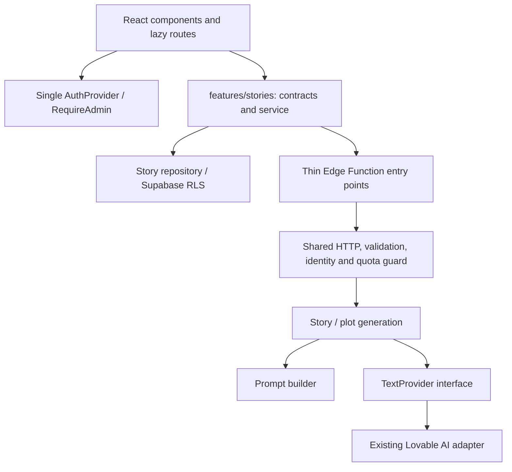

# Bubbleverse — current modular architecture

Updated 2026-11-14 after the cleanup of baseline `2856604`. Earlier `ARCHITECTURE.md`
and audit files describe historical snapshots, not the current implementation.

Keep React/Vite/TypeScript and Supabase. This is an incremental modular application;
NestJS, Redis, Python, microservices and a public API have not been introduced.

## Frontend responsibilities

- `contexts/AuthProvider.tsx` owns the single session subscription and role lookup.
  `features/auth/authState.ts` rejects stale session/role results after logout,
  account switch or unmount. Components use `hooks/useAuth.ts` rather than repeat
  SDK subscriptions and role queries.
- `features/auth/RequireAdmin.tsx` protects all admin routes before their pages mount.
  `AdminLayout` renders layout only. This frontend gate does not replace API checks/RLS.
- `features/stories/types.ts` centralizes browser story/page/character contracts and
  explicitly projects text requests without photos, local character IDs or other UI state.
- `features/stories/storyService.ts` coordinates authenticated API calls and saving.
  `storyRepository.ts` is the concrete Supabase persistence adapter.
  `storyPersistence.ts` contains testable save sequencing without React or SDK dependencies.
- New stories start as draft; characters/pages must save successfully before completion.
  Failed writes reject the operation and best-effort mark failure. Partial rows can remain:
  this is not a database transaction or a durable production workflow. `completed` here
  refers to the existing text story, not completed illustrations/PDF/delivery.
- `StoryWizard` only shows known writing/saving stages. Its former random percentage
  timers were removed. Leaving during writing aborts the browser request and suppresses
  late UI updates; an already accepted provider request may continue. Saving cannot be
  cancelled from the overlay. Durable server cancellation remains future work.
- Language context, provider and hook have separate responsibilities. Invalid stored
  locales fall back to English. Style variants live in pure `.ts` modules so JSX modules
  can support Fast Refresh without mixing non-component exports.
- Account/admin routes load on demand. The landing page still uses React Query for
  examples; the query provider and its dependency were intentionally retained.
- Fredoka is served from the existing Fontsource dependency, without Google Fonts
  network requests. No new font family was introduced.

## Server responsibilities

- `generationHandler.ts`: preflight/CORS, bounded JSON input, validation, idempotency
  key, authorization, provider readiness, quota reservation and sanitized responses.
- `supabaseAccess.ts`: verified claims, fail-closed profile/ban check and quota RPC
  using the caller's identity. No service-role credentials are sent to the browser.
- `storyPrompts.ts`: narrative/art/language instructions, shared by automatic/manual plot
  modes rather than two duplicated prompt templates.
- `storyGeneration.ts` and `plotGeneration.ts`: domain orchestration, structured page
  validation, bounded title request and localized fallback. Title errors do not discard
  validated pages or automatically regenerate/charge for the whole story.
- `textProvider.ts`: existing gateway HTTP transport, timeout, bounded token parameters,
  content checks and safe error classification. Alternate providers can implement the same
  interface without changing story logic. No paid provider was changed or invoked here.
- Function `index.ts` files only compose these modules. Deno dependencies remain pinned
  by `deno.lock`; root npm dependency removals do not change the Edge SDK version.

## Verification and extension boundaries

TypeScript checks the complete frontend source, including unused UI primitives, and now
rejects unused locals/parameters. ESLint rejects warnings and unused variables; no rules
were disabled to make the cleanup pass. Native Node tests use injected repositories,
role readers and provider transport; isolated PostgreSQL tests exercise the checked-in
security migrations. Deno checks both complete Edge entry points.

Future durable jobs, budget reservations in currency, normalized private references,
Character Bible, Story Blueprint, illustrations, PDF and commerce belong behind these
feature boundaries. B2B ownership/workspaces and public API contracts should extend the
same production engine; multi-tenancy, billing and API credentials are not implemented by
this refactor. No new paid infrastructure or hosted migration was applied.
