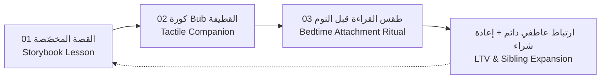
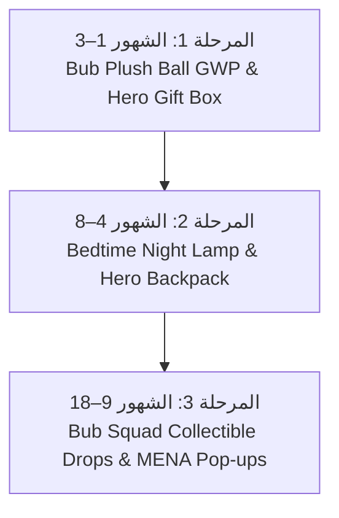

# Bubbleverse — استراتيجية منظومة العلامة التجارية للأطفال، متجر منتجات Bub، والتدقيق الشامل للتطبيق 2026
## Kids Brand Ecosystem, Free Bub Plush GWP Economics & Full-App Engineering Audit

**تاريخ الإعداد:** نوفمبر 2026 | **الأسواق المستهدفة:** مصر (`EGP`) • السعودية (`SAR`) • الإمارات (`AED`)  
**التصنيف:** وثيقة استراتيجية وتقنية تنفيذية (Executive Brand Strategy, Toy Supply Chain & Full-Codebase Audit)  
**الارتباط المعماري:** تتكامل مباشرة مع `docs/COMPETITIVE_BD_STRATEGY_2026.md`، و`docs/CURRENT_ARCHITECTURE.md`، و`DESIGN.md`، و`docs/MVP_EXECUTION_PLAN_AR.md`.

> [!IMPORTANT]
> **الخلاصة التنفيذية (Executive Thesis — From Storybook Shop to Iconic Kids Brand):**
> تتحول **Bubbleverse** في هذه المرحلة من «متجر قصص أطفال مخصصة» إلى **علامة تجارية عاطفية متكاملة للأطفال (Multi-Touchpoint Kids Brand Ecosystem)** عبر محورين متوازيين:
> 1. **التحصين الهندسي الكامل للتطبيق (10-Point Full-App Audit Remediation):** إغلاق 10 ثغرات حقيقية (4 حرجة `HIGH` + 4 متوسطة `MEDIUM` + 2 معمارية وأدائية) تغطي عمى التنفيذ والفواتير المخفية للهدايا، خصوصية صور الأطفال وسعة التخزين المحلي، توحيد العملات ISO وتحليلات المبيعات، التكافؤ الكامل لسوق الإمارات (`AED`)، وتوحيد محرك السلة بين الكتب ومنتجات البراند والهدية التلقائية.
> 2. **إطلاق محرك العلامة التجارية وهدية «كورة Bub القطيفة» (Official Merch Store + Free Bub GWP Engine):** استلهام المثلث الذهبي من رواد ألعاب الأطفال عالمياً (**Slumberkins** للطقس العاطفي، **Jellycat** لتجربة صفحة المنتج والشفافية والأمان، و**Squishmallows** لاقتصاديات الندرة وهدية الشراء GWP) لتحويل تميمة العلامة **Bub** إلى **كورة قطيفة متلألئة ملموسة** تُمنح **مجاناً كـ Gift-With-Purchase** عند السلال المؤهلة أو تُباع مستقلة بهامش يصل إلى **4×–5.5×** في الخليج.

---

## 1. ملخص التدقيق الهندسي الشامل للتطبيق — العثرات العشر الحقيقية وحلولها (Comprehensive Full-App Audit: 10 Real Findings & Fixes)

أُجري تدقيق شامل على جميع مسارات المتجر ولوحة الإدارة ومحركات السلة والتسعير والتخزين المحلي، وكشف **10 مشكلات حقيقية** تؤثر مباشرةً على التنفيذ الفعلي للطلبات، خصوصية صور الأطفال، دقة التقارير المالية، وتجربة أسواق الخليج (`SAR`/`AED`). يوثّق الجدول التالي كل مشكلة بملفاتها الدقيقة والحل الهندسي المعتمد في موجة التنفيذ الحالية:

### 1.1 مصفوفة التدقيق الشاملة (Audit Findings & Remediation Matrix)

| # | الخطورة | العنوان والمشكلة الحقيقية (Root Defect & Affected Files) | الأثر التجاري والتشغيلي (Business & Risk Impact) | الحل الهندسي المعتمد (Engineered Fix & Ownership) |
|---|---|---|---|---|
| **1** | **HIGH** | **ثغرة التنفيذ وفاتورة الهدايا (Fulfillment & Gift Invoice Blindspot)** الملفات: `src/pages/admin/AdminOrders.tsx`، `src/pages/TrackOrder.tsx`، `src/lib/localStore.ts` | أسقطت شاشة تفاصيل الطلب والفاتورة المطبوعة وتصدير CSV وصفحة تتبع الطلب 4 إضافات مدفوعة (`Gift Box`، `Stickers`، `QR Audio Story`، `Co-Hero`) إضافةً إلى `coHeroName` و`occasion` و`promoCode`/`discountAmount`. والأخطر أن `handlePrintInvoice` تجاهل خيار `giftHidePrice: true` فطبع الأسعار داخل طرد الهدية! | • تصدير دالة مشتركة `summarizeOrderItemAddons(item, lang)` في `localStore.ts` لتوحيد قراءة الإضافات الخمس والمناسبة وشريط الاسم `ribbonName`. • عرض كامل الشارات والإضافات وبيانات Merch وهدية GWP في `AdminOrders` و`TrackOrder`. • تفعيل **وضع إيصال الهدايا (`Gift Packing Slip Mode`)** في `handlePrintInvoice` عند `giftHidePrice === true` لإخفاء كافة الأسعار والإجماليات والعربون. • توسيع أعمدة CSV لتشمل الإضافات، كود الخصم، نوع الهدية، ونوع العنصر (`Book/Merch/GWP`). |
| **2** | **HIGH** | **تسرب خصوصية صور الأطفال وخطر تجاوز سعة `localStorage` (Child Photo Privacy & 5MB Quota Risk)** الملفات: `src/components/StoryWizard.tsx`، `src/pages/ProductDetail.tsx` | وضع `StoryWizard` صورة الطفل الخام (`base64`) داخل `coverImage` مما أدى لكتابتها في سجلات الطلبات بـ`localStorage` وملفات النسخ الاحتياطي JSON بدلاً من حصرها في `photoVault` (`IndexedDB`). كما افتقر `ProductDetail` للتحقق عبر `validateCharacterPhoto` وضغط الصور المصغرة، مما يعرض السلال متعددة الكتب لانهيار حد `5MB` في `localStorage`. | • منع وضع صورة الطفل في `coverImage` نهائياً داخل `StoryWizard` واعتماد غلاف فني ثابت، مع تمرير معاينة مضغوطة فقط في `photoPreview` لتُحفظ حصرياً داخل `IndexedDB photoVault` عند إتمام الطلب. • تفعيل `validateCharacterPhoto` (`JPG/PNG/WEBP ≤ 10MB`) وضغط الصورة عبر Offscreen HTML5 Canvas إلى `480px` JPEG (`quality: 0.78`, `~25–45 KB`) داخل `ProductDetail`. |
| **3** | **HIGH** | **تضارب رموز العملات وتشويه مخطط المبيعات (Currency Code Mismatch & Cross-Currency Distortion)** الملفات: `src/components/cart/GuestCheckoutModal.tsx`، `src/pages/admin/AdminOverview.tsx`، `src/features/commerce/pricingEngine.ts`، `src/lib/localStore.ts` | حفظ `GuestCheckoutModal` رموز عرض مترجمة (`'ج.م'` / `'ر.س'`) بدلاً من أكواد ISO القياسية (`'EGP'` / `'SAR'` / `'AED'`). وجمع `AdminOverview` أرقام المبيعات الخام من `EGP + SAR + AED` في مخطط واحد (7 أيام) مما شوه الإيرادات تماماً! | • إضافة `normalizeCurrencyCode()` و`formatMoney()` في `pricingEngine.ts`. • فرض الحفظ بأكواد ISO القياسية (`EGP`/`SAR`/`AED`) داخل `GuestCheckoutModal` و`saveOrder()`. • تزويد مخطط المبيعات لـ7 أيام في `AdminOverview` بمحول عملات صريح (`EGP` / `SAR` / `AED`) يفصل إيراد كل سوق بدقة دون خلط. |
| **4** | **HIGH** | **غياب التكافؤ لسوق الإمارات (`AED`) والإضافات الخمس (Missing UAE/AED & 5-Add-on Parity)** الملفات: `AdminConfig.tsx`، `AdminCatalog.tsx`، `StoryWizard.tsx`، `StoriesByAgeGender.tsx`، `CartDrawer.tsx` | لم توجد واجهة لتعديل `uaePaymentDetails` في `AdminConfig`؛ وافتقر `AdminCatalog` لحقول أسعار `AED` ووسوم المناسبات وتفعيل البطل الثاني `supportsCoHero`؛ واعتمد `StoryWizard` أسعار تلوين صلبة (`75`/`19`) دون `AED` أو الإضافات الأربع أو خيار ثنائي اللغة؛ وعرض `StoriesByAgeGender` و`CartDrawer` شارات `EGP` فقط. | • إضافة بطاقة **بيانات الدفع للإمارات (`Apple Pay`، `Tabby/Tamara`، `UAE IBAN`)** في `AdminConfig`. • إضافة حقول `priceAed*` ووسوم المناسبات وزر `supportsCoHero` في `AdminCatalog`. • ربط `StoryWizard` بمحرك `ADDON_PRICING` و`calculateAddonTotal` مع الإضافات الأربع وخيار `عربي وإنجليزي / Bilingual` و`EGP • SAR • AED`. • تعميم عرض العملات الثلاث في `StoriesByAgeGender` وشارات إضافات `CartDrawer`. |
| **5** | **MEDIUM** | **ضياع ملاحظات الطلب بين السلة والدفع (Dropped `orderNotes` Handoff)** الملفات: `src/contexts/CartContext.tsx`، `src/components/cart/CartDrawer.tsx`، `src/components/cart/GuestCheckoutModal.tsx` | كانت الملاحظات التي يكتبها ولي الأمر داخل `CartDrawer` مخزنة محلياً وتضيع فور الانتقال إلى نافذة `GuestCheckoutModal`. | • رفع حالة `orderNotes` و`setOrderNotes` إلى `CartContext` (تُصفّر تلقائياً عند `clearCart`) وربط كل من `CartDrawer` و`GuestCheckoutModal` بها لضمان وصول ملاحظات التوصيل والإهداء كاملة. |
| **6** | **MEDIUM** | **هشاشة التهيئة المحلية، النسخ الاحتياطي، الروابط المكسورة وحد الشحن الثابت (Unsafe Hydration, Backup v2.2 & Slug/Threshold Guards)** الملفات: `CartContext.tsx`، `localStore.ts`، `AdminConfig.tsx`، `ProductDetail.tsx`، `CartDrawer.tsx` | غياب التحقق الدفاعي عند قراءة السلة من `localStorage`؛ عدم دمج القصص وحقول `AED` الجديدة تلقائياً للزوار العائدين؛ قصور مدقق النسخ الاحتياطي عن شمول كل الجداول؛ عرض `stories[0]` صامتاً عند رابط قصة خاطئ؛ وتثبيت حد الشحن المجاني عند `2` بدلاً من `storeConfig.freeShippingThreshold`. | • تهيئة دفاعية للسلة مع تنظيف عناصر `isFreeGift` العالقة في `CartContext`. • دمج تلقائي للحقول والقصص الناقصة داخل `getCatalogStories()`. • ترقية النسخ الاحتياطي إلى **Backup v2.2** (متوافق رجعياً مع v2.0/v2.1) ليشمل `merchCatalog` و`gwpConfig` وكافة سجلات النمو مع التحقق الكامل في `AdminConfig`. • عرض بطاقة "القصة غير موجودة" الأنيقة في `ProductDetail` عند slug خاطئ، وربط شريط الشحن المجاني بـ`storeConfig.freeShippingThreshold`. |
| **7** | **MEDIUM** | **صفحة 404 إنجليزية غير منسّقة وغياب شريط التنقل في المعالج (Unstyled 404 & Stranded Wizard Nav)** الملفات: `src/pages/NotFound.tsx`، `src/components/StoryWizard.tsx` | صفحة 404 افتراضية إنجليزية فقط بخلفية رمادية باهتة ورابط `<a href="/">` يعيد تحميل التطبيق كاملاً؛ وافتقر `StoryWizard` لشريط علوي واضح للعودة للرئيسية أو الوصول للسلة/اللغة. | • إعادة بناء `NotFound.tsx` بهوية **Midnight Magic** ثنائية اللغة (`AR RTL` + `EN LTR`) مع `<Header />` و`<Footer />` وشخصية Bub وروابط SPA (`/`، `/stories`، `/merch`). • إضافة شريط علوي مريح داخل `StoryWizard` بزر «العودة للرئيسية / Back to Home» وسياق اللغة والسلة. |
| **8** | **MEDIUM** | **تراكم 14 ملفاً إرثياً غير مستخدم (Legacy Dead-Code Hygiene)** الملفات: 14 ملفاً موثقاً أدناه في القسم `1.2` | بقاء مكونات وخطافات وصفحات إدارة قديمة بعد ترشيق الصفحة الرئيسية ودمج لوحة الإدارة يربك المطورين الجدد ويزيد تكلفة الصيانة. | • جرد وتوثيق دقيق للملفات الـ14 غير المرجعية مع التفريق الواضح بينها وبين وحدات `CX-002` الخلفية المحتفظ بها عمداً (`storyService.ts`) تمهيداً لإزالتها في دفعة تنظيف آمنة مستقلة. |
| **9** | **LOW / PERF** | **أداء تحميل الصور وضغط أغلفة الكتالوج الإداري (Image Lazy-Loading & Admin Cover Quota Guard)** الملفات: `src/components/showcase/StoriesByAgeGender.tsx`، `src/pages/admin/AdminCatalog.tsx` | غياب `loading="lazy" decoding="async"` على بطاقات القصص في الرئيسية؛ وحفظ أغلفة الكتالوج المرفوعة من الإدارة بدون ضغط داخل `localStorage`. | • إضافة `loading="lazy" decoding="async"` على أغلفة القصص في `StoriesByAgeGender`. • ضغط صور الأغلفة المرفوعة في `AdminCatalog` عبر Canvas (`max 960px`, JPEG `0.82`) لحماية سعة المتصفح. |
| **10** | **ARCH** | **نموذج تجاري محصور بالكتب دون عزل للـMerch وهدية GWP (Book-Only Commerce Model & Shipping/Discount Leakage)** الملفات: `pricingEngine.ts`، `gwpEngine.ts`، `merchCatalog.ts`، `cart.ts`، `CartContext.tsx`، `GuestCheckoutModal.tsx` | افترض محرك السلة والدفع أن كل عنصر هو كتاب (`digital_pdf` أو `hardcover_book`)، مما كان سيؤدي لخطأين خطيرين عند إضافة منتجات Bub أو هدية GWP: (أ) احتساب الهدية المجانية ضمن عداد خصم الإخوة (15%/25%) أو حد الهدية نفسها (حلقة لا نهائية)، و(ب) إغفال عنوان الشحن الفعلي لطلب يجمع كتاب PDF رقمي + كورة Bub قطيفة مادية. | • توسيع العقد إلى `itemType: 'book' | 'merch' | 'gwp_gift'` و`format: 'hardcover_book' | 'digital_pdf' | 'physical_merch'`. • عزل عناصر `isFreeGift` تماماً عن المجموع الفرعي وخصم الإخوة في `pricingEngine.ts` و`gwpEngine.ts`. • تفعيل كشف الشحن المادي (`requiresPhysicalShipping`) لأي طلب يحوي كتاباً مطبوعاً أو منتج Merch أو هدية GWP مادية، مع 100% تغطية اختبارات آلية في `scripts/merch-gwp.test.mjs`. |

---

### 1.2 جرد الملفات الإرثية الـ 14 غير المستخدمة (Verified 14 Legacy Unused Files Inventory)

تحققنا برمجياً عبر فحص كامل الاستيرادات في `src/` و`scripts/` من وجود **14 ملف واجهة وخطاف وإدارة إرثي غير مستدعى حالياً** (مع ملاحظة أن `src/features/stories/storyService.ts` **لا يُعد ملفاً ميتاً**، بل هو طبقة الربط الخلفي الموثّقة لمرحلة `CX-002` في `docs/CURRENT_ARCHITECTURE.md`):

| الفئة | المسار الدقيق في المستودع | سبب عدم الاستخدام والبديل الفعلي الحالي | توصية الحوكمة |
|---|---|---|---|
| **مكونات الرئيسية الإرثية (4)** | `src/components/ExamplesSection.tsx` `src/components/HeroShowcase.tsx` `src/components/B2BSection.tsx` `src/components/showcase/CareerAdventuresBanner.tsx` | أُزيلت من `Index.tsx` ضمن ترشيق القمع التحويلي إلى 5 أقسام مركزة، واستُبدلت بـ`HeroSection` و`StoriesByAgeGender` (شاملة تبويب المهن) وبوابة `/schools`. | أرشفة/حذف في PR تنظيف مستقل بعد التحقق من عدم الاعتماد عليها في أي فرع. |
| **مكونات معالج v1 الإرثية (3)** | `src/components/CharacterUpload.tsx` `src/components/GeneratingScreen.tsx` `src/components/StoryPreview.tsx` | مكونات الجيل الأول لمعالج التوليد؛ حلت محلها خطوات `StoryWizard` المحدثة و`LiveBookPreviewCard` و`AdminStudio`. | الاحتفاظ الموقت إن كان هناك ربط قادم مع `CX-002` أو الحذف عند توحيد تجربة المعالج. |
| **خطافات مخصصة غير مستخدمة (2)** | `src/hooks/useMousePosition.ts` `src/hooks/useScrollPosition.ts` | استبدلتها فيزياء Framer Motion في `TiltBookCard` وحلول التمرير الأخف. | حذف آمن في PR التنظيف. |
| **صفحات إدارة قديمة (5)** | `src/pages/admin/AdminB2B.tsx` `src/pages/admin/AdminBrand.tsx` `src/pages/admin/AdminExamples.tsx` `src/pages/admin/AdminStories.tsx` `src/pages/admin/AdminUsers.tsx` | دُمجت وظائف B2B في `AdminGrowth.tsx`، والأمثلة والقصص في `AdminShowcase.tsx` و`AdminCatalog.tsx` و`AdminStudio.tsx`، والبراند في `AdminConfig.tsx` و`AdminMerch.tsx` (مع بقاء `AdminUsers` كمرجع لتفعيل حسابات Supabase B2C لاحقاً). | إزالة الصفحات المكررة الأربعة، والإبقاء المشروط على `AdminUsers.tsx` لمرحلة تفعيل الحسابات. |

---

## 2. البحث العميق لبناء علامة أطفال عالمية ومنتجات Merch (Deep Kids Brand & Merch Research)

لتحويل **Bubbleverse** من مجرد متجر كتب مخصصة إلى علامة محبوبة تدخل غرفة نوم الطفل وترافقه يومياً، دُرست ثلاث مدارس عالمية رائدة في اقتصاديات ألعاب الأطفال والقصص (**Slumberkins**، **Jellycat**، **Squishmallows**) وتُرجمت مباشرة إلى ميزات ملموسة داخل الكود ومنظومة المنتجات:

### 2.1 دولاب الزخم العاطفي من Slumberkins (The 3-Step Emotional Flywheel)

أثبتت **Slumberkins** (التي أسستها معالجة أسرية ومربية أطفال) أن دمج «الكتاب» مع «الدمية الملموسة» يرفع القيمة المدركة ويحوّل المنتج من هدية تُقرأ مرة واحدة إلى **أداة طقس يومي يعتمد عليها الأهل لتهدئة الطفل وبناء ثقته بنفسه**:

- **الخطوة 1 — القصة المخصّصة (The Lesson):** الطفل يرى نفسه بطلاً شجاعاً ولطيفاً في حكايته المطبوعة (`8.5"×8.5"`).
- **الخطوة 2 — كورة Bub القطيفة (The Tactile Transfer Object):** بمجرد إغلاق الكتاب، ينتقل الإحساس بالأمان والبطولة من الورق إلى **كورة Bub القطيفة الناعمة** (بعيون مطرزة 100% وملمس حريري مهدئ للجهاز العصبي دون أي قطع بلاستيكية صلبة).
- **الخطوة 3 — طقس ما قبل النوم (The Bedtime Ritual):** تفتح القصة + كورة Bub + أباجورة Starlight لاحقاً روتيناً مسائياً خالياً من الشاشات (Screen-Free Routine) يعزز الثقة بالنفس، ويدفع الأم لشراء قصص ومنتجات جديدة للإخوة وفي أعياد الميلاد.
- **التطبيق المباشر في Bubbleverse:** شريط المراحل الثلاث في `/merch` (`MerchStore.tsx`)، تبويب **«طقس القراءة والنوم / Bedtime Ritual»** داخل `BubSizeAndSafetyWidget.tsx`، وبطاقة الربط المتبادل في `/merch/:id` (`MerchDetail.tsx`).

---

### 2.2 مخطط عرض وتجربة صفحة المنتج من Jellycat (The Jellycat Merchandising Blueprint)

نجحت **Jellycat** في بيع دمى قطيفة بهوامش فاخرة عبر الإنترنت لأنها تعالج **أكبر خوفين لدى الأهل عند شراء لعبة أونلاين**: (1) *«كم حجمها الحقيقي مقارنة بيد طفلي؟»* و(2) *«هل هي آمنة 100% للمواليد وقابلة للغسيل؟»*. وقد طُبّقت العناصر الأربعة التالية داخل صفحة `/merch/:id`:

1. **أداة المقارنة البصرية التفاعلية «كم حجم Bub الحقيقي؟» (`How Big Is Bub?`):**
   - نافذة تفاعلية داخل `BubSizeAndSafetyWidget.tsx` تقارن نسبياً بين:
     - هاتف ذكي قياسي (**`14.5 cm`**)
     - كتاب Bubbleverse المقوّى (**`21.6 cm` / `8.5"×8.5"`**)
     - مقاسات كورة Bub الثلاثة (**`Mini 12cm`** • **`Classic 20cm`** • **`Jumbo 30cm`**) بتبديل فوري حيّ وبأرقام LTR منضبطة داخل الواجهة العربية.
2. **سرد شخصية «حكاية Bub» (`Bub's Tale` Character Lore):**
   - استبدال الوصف التقني الجاف بسرد ساحر يمنح Bub شخصية دافئة ومرحة، مع ملامح مطرزة بسيطة تشجع الطفل على إسقاط خياله ومشاعره عليها.
3. **شفافية الأمان المطلقة (`0+` Embroidered-Eye Safety & Washability):**
   - إظهار مواصفات الأمان الصريحة داخل بطاقة الأمان والأكورديون: **عيون وابتسامة مطرزة 100%** (صفر عيون بلاستيكية أو خرز قابل للبلع)، حشو قطن سحابي مضاد للحساسية (`Hypoallergenic 7D PP Cotton`)، أصباغ خالية من الآزو (`Non-Azo`)، امتثال مستهدف لمعايير **EN-71 (الأوروبية)** و**ASTM F963 (الأمريكية)** و**ISO-8124**، وإرشادات واضحة لإنعاش شكل اللعبة بعد الفتح (Fluff & Wake-Up) والغسيل اللطيف.
4. **لمسة التغليف والتخصيص العاطفي (`Satin Keepsake Ribbon` & Luxury Gift Box):**
   - شريط ساتان مجاني يُطبع عليه اسم الطفل (*«صديق البطل: [الاسم]» / «Best Buddy of [Name]»*) عبر حقل `allowsRibbonName` + خيار صندوق القصة الفاخر + وضع إيصال الهدايا الخالي من الأسعار (`giftHidePrice: true`).

---

### 2.3 اقتصاديات السلوك من Squishmallows وهدية الشراء المجانية (Behavioral Economics: Why Free Bub GWP Beats % Discounts)

تعتمد **Squishmallows** على **تأثير السعر الصفري (Zero-Price Effect)**، و**الندرة اللطيفة (Soft Scarcity)**، و**نفسية المجموعة (Squad Completionism)**. وعند تطبيق هذا المبدأ في Bubbleverse، يتفوق نظام **«كورة Bub القطيفة هدية مجانية مع الطلب» (Free Bub GWP)** على الخصم النقدي (`-20%`) في أربعة محاور حاسمة:

| معيار المقارنة | الخصم النقدي التقليدي (`-20% OFF`) | **هدية كورة Bub القطيفة المجانية (`Free Bub GWP`)** |
|---|---|---|
| **حماية هيبة السعر (Brand Equity)** | يدرّب العملاء على انتظار الكوبونات ويخفض السعر المرجعي للكتاب. | **يحافظ على السعر الكامل للكتاب 100%** ويعزز تموضع Bubbleverse كعلامة فاخرة. |
| **القيمة المدركة مقابل التكلفة** | خصم 150 ج.م أو 33 ر.س يُدرك بالضبط بـ 150 ج.م أو 33 ر.س (**1.0×**). | كورة Bub بتكلفة واصلة ~11 ر.س (أو ~135 ج.م) تُدرك بقيمتها البيعية 49 ر.س / 190 ج.م (**3×–4.4× قيمة عاطفية ومدركة**!). |
| **الانتشار الفيروسي (TikTok / Reels UGC)** | لا أحد يصوّر فيديو لـ «خصم 20%». | **اللحظة الذهبية لفتح الصندوق:** الطفل يحتضن كورة Bub المتلألئة بجانب كتابه المطبوع، ما يضاعف فيديوهات الأمهات العفوية ويخفض CAC. |
| **رفع متوسط السلة (AOV Lift)** | يخفض إجمالي الفاتورة الصافي لكل طلب. | **يرفع متوسط السلة فوق العتبة (`700 EGP` / `155 SAR` / `155 AED` أو كتابين)** لتحويل مشتري كتاب واحد (450–500 EGP) إلى نسخة فاخرة 25 صفحة أو كتابين للإخوة! |

---

## 3. تصنيع كورة Bub القطيفة واقتصاديات الوحدة في الشرق الأوسط (Toy Manufacturing & MENA Unit Economics)

> [!NOTE]
> **إفصاح الشفافية المالية (Financial Governance per `docs/MVP_EXECUTION_PLAN_AR.md`):**
> أسعار البيع وقواعد GWP في الجداول أدناه **مطابقة 100% للكود الفعلي** في `src/features/merch/merchCatalog.ts` و`src/features/commerce/gwpEngine.ts` و`src/features/commerce/pricingEngine.ts`. أما أرقام التصنيع والشحن والجمارك (`FOB / DDP Landed Cost`) وتكلفة الاستحواذ (`CAC`) فهي **معايير تخطيطية واقعية (Planning Benchmarks)** مستندة لمتوسطات مصانع دونغقوان وشحن DDP للمنطقة، وتُعتمد نهائياً بعد استلام عينات المصنع وفواتير الموردين الفعليين.

### 3.1 سلسلة التوريد، المواصفات الفنية، والامتثال التنظيمي (Dongguan OEM & MENA Compliance)

1. **استراتيجية التوريد والتصنيع (Dual-Track Sourcing):**
   - **المسار الأول — تصنيع OEM في دونغقوان، الصين (Dongguan Plush Hub):** المركز العالمي الأول للدمى القطيفة الفاخرة.
     - **الحد الأدنى للطلب (MOQ):** **`300 – 500 قطعة`** لكل مقاس/تصميم عند استخدام أقمشة فلبوا متلألئة متوفرة بالمخزون (Stock Iridescent Spandex/Crystal Velboa)، وزمن تجهيز العينة **`7–10 أيام عمل`**.
     - **الشحن بالضغط المفرّغ من الهواء (`Vacuum-Compressed DDP Shipping`):** الألعاب القطيفة تتكبد رسوم «وزن حجمي» (Volumetric Weight) مرتفعة؛ الضغط المفرّغ يخفض الحجم الشحني بنسبة **`55%–70%`** مما يحمي التكلفة الواصلة مع إلزامية اختبار ارتداد الحشو (Rebound Test 24–48 ساعة) على العينة قبل الإنتاج الكمي.
   - **المسار الثاني — مسار مصر المحلي التكميلي (Egypt Local Cut-and-Sew Option):** لتفادي تقلبات الاستيراد والجمارك في مصر على المدى المتوسط، يمكن استيراد القماش المتلألئ المعتمد فقط وتفصيل وتطريز وحشو كرات Bub في ورشة ألعاب أطفال متخصصة في القاهرة/العبور، ما يخفض التكلفة المحلية لمقاس Classic 20cm إلى `~135–165 EGP` بمرونة إعادة توريد خلال 10–14 يوماً.
2. **مواصفات الأمان الإلزامية في ملف التصنيع (`Tech Pack`):**
   - **القماش:** Spandex-Polyester / Crystal Velboa فائق النعومة بلمعة قوس قزح آمنة (خالي من الجليتر المتساقط أو الفثالات والأصباغ الآزوية `Non-Azo`).
   - **الملامح:** **تطريز 100% بالكامل** للعيون والابتسامة والخدود (منع تام للعيون البلاستيكية أو الخرز لتأهيل الفئة العمرية **`0+`**).
   - **الحشو:** قطن بوليستر مجوف `7D PP Hypoallergenic Cloud Fill` مقاوم للتكتل وقابل للغسيل اللطيف.
   - **بطاقة الهوية والغسيل:** بطاقة قماشية مخيطة (`Sewn-in Batch & Care Label`) تحمل رقم الدفعة وعلامات الأمان وتعليمات الغسيل.
3. **بوابات الامتثال والجمارك حسب السوق (Regulatory Gateways):**
   - **المرجعية المخبرية الموحدة:** تقرير اختبار معتمد من معمل ISO 17025 (مثل SGS / Intertek / Bureau Veritas) وفق **`EN-71` (أجزاء 1، 2، 3)** و**`ASTM F963`** و**`ISO-8124`**.
   - **السعودية (KSA — `SASO / Saber`):** تسجيل المنتج في منصة **سابر (Saber)** واستصدار شهادة مطابقة منتج (`PCoC`) وشهادة مطابقة إرسالية (`SCoC`) وفق اللائحة الفنية الخليجية لألعاب الأطفال (`G-Mark` / Gulf Toy Technical Regulation).
   - **الإمارات (UAE — `MoIAT / ESMA`):** مطابقة نظام تقويم المطابقة الإماراتي (**ECAS**) لألعاب الأطفال قبل التخليص الجمركي.
   - **مصر (Egypt — `GOEIC / ACID`):** التسجيل المسبق للشحنات (`ACID / Nafeza`) وشهادة الفحص قبل الشحن مطابقة للمواصفات القياسية للعب الأطفال (أو التصنيع المحلي المعتمد).

---

### 3.2 جدول التكلفة الواصلة والهوامش — البيع المستقل لمنتجات Bub (Standalone Merch Unit Economics)

| المنتج / المقاس (`SKU`) | التكلفة الواصلة التقديرية (`Est. Landed DDP`) | سعر البيع — مصر (`EGP`) | هامش مصر (`Est. GM%`) | سعر البيع — الخليج (`SAR / AED`) | هامش الخليج (`Est. GM%` / المضاعف) | الدور الاستراتيجي |
|---|---|---|---|---|---|---|
| **كورة Bub ميني 12 سم** (`BV-BUB-MINI-12`) | `$2.65–$3.10` (`~135 EGP` / `~11 SAR`) | **190 EGP** | **~29%** | **49 SAR / AED** | **~78% (4.5×)** | **نجمة هدية GWP** وميدالية الشنطة |
| **كورة Bub كلاسيك 20 سم** (`BV-BUB-CLASSIC-20`) | `$3.90–$4.80` (`~195 EGP`* / `~16.5 SAR`) | **340 EGP** | **~43%–53%*** | **89 SAR / AED** | **~81% (5.4×)** | **الأكثر مبيعاً مستقلاً** (نطاق 290–450 EGP / 79–119 SAR) |
| **كورة Bub جامبو 30 سم** (`BV-BUB-JUMBO-30`) | `$5.80–$6.20` (`~295 EGP` / `~23 SAR`) | **520 EGP** | **~43%** | **135 SAR / AED** | **~83% (5.9×)** | وسادة حضن للنوم وهدايا VIP |
| **صندوق القصة الفاخر + كورة Bub** (`story-bub-giftbox`) | `~290 EGP` / `~42 SAR` | **690 EGP** (قبل 840) | **~58%** | **169 SAR / AED** (قبل 209) | **~75% (4.0×)** | حزمة الهدايا الأيقونية (-18%) |
| **أباجورة Bub المضيئة للنوم** (`bub-night-lamp`) | `$4.50–$5.50` (`~220 EGP` / `~20 SAR`) | **420 EGP** | **~48%** | **109 SAR / AED** | **~82% (5.5×)** | سيليكون غذائي BPA-Free + 7 ألوان (المرحلة 2) |
| **شنطة الأبطال + ميدالية Bub** (`hero-adventure-backpack`) | `$6.20–$7.50` (`~310 EGP` / `~28 SAR`) | **580 EGP** | **~47%** | **149 SAR / AED** | **~81% (5.3×)** | دخول الحضانات والمدارس (Back-to-School) |
| **حقيبة التلوين والستيكرز** (`bub-activity-kit`) | `~75 EGP` / `~14 SAR` | **240 EGP** | **~69%** | **65 SAR / AED** | **~78% (4.6×)** | منتج دخول سريع ورفع سلة (Cross-Sell) |
| **مجموعة عائلة Bub الثلاثية** (`bub-squad-trio`) | `~490 EGP`* / `~50 SAR` | **820 EGP** (قبل 1050) | **~40%–46%** | **215 SAR / AED** (قبل 273) | **~77% (4.3×)** | حزمة المقتنين وهدايا الإخوة |

*\*ملاحظة: في مصر، يرتفع هامش Classic 20cm إلى ~53% عند التحول للتفصيل المحلي أو الشحن البحري المجمع بدفعات 500–1,000 قطعة (~160 EGP واصل).*

---

### 3.3 الإثبات المالي لنظام هدية Bub المجانية (`Free Bub GWP Economics` مقابل الخصم 20%)

تُضبط قواعد GWP الافتراضية في `src/features/commerce/gwpEngine.ts` على وضع **`any_hardcover_or_threshold`**: تُفتح هدية **كورة Bub ميني 12 سم (`BV-BUB-MINI-12`)** تلقائياً عند شراء **كتابين فأكثر** أو بلوغ المجموع المدفوع **`700 EGP`** (مصر) أو **`155 SAR`** (السعودية) أو **`155 AED`** (الإمارات) — أي أن **نسخة واحدة فاخرة 25 صفحة (`750 EGP` / `165 SAR/AED`)** أو **سلة كتابين** تفتح الهدية فوراً!

#### أ) مقارنة ربحية سلة الكتاب الفاخر 25 صفحة (Deluxe Hardcover — نفس `CAC`: `130 EGP` في مصر / `32 SAR` في الخليج)

| السوق والسيناريو | الإيراد الصافي | تكلفة الكتاب (`COGS`) | تكلفة الهدية (`GWP`) | الربح الإجمالي | تكلفة الاستحواذ (`CAC`) | **صافي الربح النقدي** | **التفوق الصافي لـ GWP** |
|---|---|---|---|---|---|---|---|
| **مصر — خصم 20% (`-150 EGP`)** | `600 EGP` | `305 EGP` | `0 EGP` | `295 EGP` | `130 EGP` | **`165 EGP` (27.5%)** | خط الأساس (تآكل السعر + صفر لعبة) |
| **مصر — هدية Bub GWP مجانية** | **`750 EGP`** | `305 EGP` | `135 EGP` | `310 EGP` | `130 EGP` | **`180 EGP` (24.0%)** | **`+15 EGP` ربح نقدي أعلى** + لعبة بيد الطفل + UGC! |
| **الخليج — خصم 20% (`-33 SAR`)** | `132 SAR` | `62 SAR` | `0 SAR` | `70 SAR` | `32 SAR` | **`38 SAR` (28.8%)** | خط الأساس |
| **الخليج — هدية Bub GWP مجانية** | **`165 SAR`** | `62 SAR` | **`11 SAR`** | `92 SAR` | `32 SAR` | **`60 SAR` (36.4%)** | **`+22 SAR` ربح نقدي أعلى (+58% صافي ربح!)** |

#### ب) اقتصاديات سلة الإخوة المدعومة بالهامش الإضافي (2-Book Sibling Basket Subsidy)

- **سوق مصر:** عميل يشتري كتاباً واحداً 15 صفحة (`450 EGP`) يترك صافي ربح **`80 EGP`** بعد `CAC 130 EGP`. عندما يحفّزه شريط GWP في السلة للترقية إلى **كتابين 15ص (`2×500 EGP` بخصم `-15%` = `850 EGP`) + علبة هدايا (`95 EGP`) = `945 EGP`**:
  - التكاليف المباشرة (`480` كتابين + `28` علبة + `60` شحن مجاني + `135` كورة Bub GWP) = `703 EGP`.
  - الربح الإجمالي = `242 EGP` -> بعد `CAC 130 EGP` = **صافي ربح `112 EGP` (+40% ربح نقدي إضافي فوق الكتاب المفرد!)** مع شحن مجاني وهدية قطيفة مجانية بالكامل.
- **سوق السعودية والإمارات:** الترقية إلى **كتابين 15ص (`2×110 SAR` بخصم `-15%` = `187 SAR`) + علبة هدايا (`25 SAR`) = `212 SAR`**:
  - التكاليف المباشرة (`96` كتابين + `7` علبة + `22` شحن مجاني + `11` كورة Bub GWP) = `136 SAR`.
  - الربح الإجمالي = `76 SAR` -> بعد `CAC 32 SAR` = **صافي ربح `44 SAR` (+132% ربح نقدي أعلى من الكتاب المفرد `19 SAR`!)**.

> [!TIP]
> **قاعدة التحكم الذكي في لوحة الإدارة (`/admin/merch`):**
> صُمم محرك `gwpEngine.ts` بمرونة كاملة تتيح للمؤسس عبر `/admin/merch` تعديل عتبة الهدية (`minBooks` / `minSubtotalEgp/Sar/Aed`) أو تبديل وضع التفعيل أو اختبار الأثر عبر **محاكي السلة الحي (`Live GWP Cart Simulator`)** فوراً مع مواسم رمضان والعيد وتغير أسعار الشحن دون لمس الكود.

---

## 4. خارطة طريق توسّع علامة Bubbleverse للأطفال (3-Phase Kids Brand Expansion Roadmap)

### المرحلة 1 (الشهور 1–3): ترسيخ الأيقونة — `Bub Plush Ball GWP & Hero Gift Box`
- **الهدف:** إثبات رفع متوسط السلة (`AOV Lift +25%–40%`) وتوليد محتوى فتح الصناديق (`Unboxing UGC`) بأقل مخاطرة مخزون.
- **المنتجات النشطة:**
  1. `bub-plush-ball` (دفعة اختبارية `300–500` قطعة من `Mini 12cm` للـGWP + `200` قطعة `Classic 20cm` للبيع المستقل).
  2. `story-bub-giftbox` (تغليف فخم محلي في القاهرة/الرياض يضم الكتاب المخصّص + كورة Bub + شريط اسم الطفل).
  3. `bub-activity-kit` (مطبوع محلياً بهامش ~69%–78% وبلا تعقيدات جمركية).
- **بوابات التحقق (Go/No-Go Gates):** الوصول إلى نسبة فتح GWP `>= 35%` من الطلبات، ونسبة إرفاق Merch `>= 15%`، ومعدل مرتجعات وتلفيات `< 2%` قبل طلب الدفعة الثانية.

### المرحلة 2 (الشهور 4–8): التوسّع في روتين اليوم والمدرسة — `Bedtime Night Lamp & Hero Backpack`
- **الهدف:** تحويل Bubbleverse من مناسبة هدايا عابرة إلى حضور يومي في غرفة النوم والحضانة والمدرسة (موسم العودة للمدارس `Back-to-School` ومواسم الأعياد).
- **المنتجات:**
  1. `bub-night-lamp` (**أباجورة Bub المضيئة للنوم** — سيليكون غذائي BPA-Free قابلة للشحن `USB-C` بـ7 ألوان مهدئة) لإكمال ثلاثية طقس النوم مع القصة وكورة Bub.
  2. `hero-adventure-backpack` (**شنطة الأبطال المبطنة + ميدالية Bub**) كمدخل مثالي لعقود المدارس والحضانات عبر بوابة `/schools` (حزمة التخرج: *كتاب مخصّص + شنطة الأبطال + شهادة تخرج*).
- **تفعيل B2B Merch Bundles:** إضافة خيار «تضمين كورة Bub أو شنطة الأبطال» في عروض المدارس والشركات (HR Family Day Gifts).

### المرحلة 3 (الشهور 9–18): الندرة المجمّعة والتجزئة التجريبية — `Collectible "Bub Squad" Drops & MENA Pop-ups`
- **الهدف:** بناء مجتمع مقتنين (Squishmallows Playbook) وحضور مادي فاخر في عواصم المنطقة.
- **إصدارات «عائلة Bub» المحدودة (`Seasonal Bub Squad Drops`):**
  - إطلاق شخصيات إصدار محدود (`250–500 قطعة مرقّمة`) مثل: **Bub رائد الفضاء (Astro Bub)**، **Bub هلال رمضان (Crescent Bub)**، **Bub التخرج (Grad Bub)**، وحزمة `bub-squad-trio`.
  - ربط كل إصدار محدود بقصة موسمية مطابقة وإتاحة **الحجز المبكر الحصري لأعضاء نادي أعياد الميلاد (`/gift-club`)**.
- **أكشاك تجريبية فاخرة (`Experiential Retail Pop-ups` — القاهرة • الرياض • دبي):**
  - منصات موسمية في المولات العائلية الكبرى (مثل: *Cairo Festival City / Mall of Arabia* في القاهرة، *Riyadh Park / Boulevard* في الرياض، *Dubai Hills Mall / Mall of the Emirates* في دبي).
  - تجربة **«اصنع قصة طفلك في 3 دقائق وخذ كورة Bub الآن!»**: جهاز لوحي يشغّل المعاينة الحية الفورية (`LiveBookPreviewCard`)، فيخرج الطفل من الكشك محتضناً كورة Bub فوراً بينما يُشحن كتابه المطبوع إلى المنزل خلال 3–5 أيام!

---

## 5. خريطة التتبع الكاملة لقاعدة الكود (Full Codebase Traceability Map)

تربط الخريطة التالية كل ركيزة في هذه الاستراتيجية وكل إصلاح من إصلاحات التدقيق العشر بالمسار البرمجي الدقيق المسؤول عنه في `d:\Private\Bubbleverse`:

| المسار / الملف البرمجي | الدور المعماري والاستراتيجي | العثرات / الميزات المغطاة |
|---|---|---|
| `src/features/merch/merchCatalog.ts` | كتالوج المنتجات الستة (`DEFAULT_MERCH_PRODUCTS`) بـ3 عملات، مقاسات `Mini/Classic/Jumbo`، حكاية Bub، ومواصفات الأمان. | Merch Ecosystem • Arch #10 |
| `src/features/commerce/gwpEngine.ts` | محرك هدية كورة Bub المجانية (`evaluateGwpEligibility`، `DEFAULT_GWP_CONFIG`) بـ3 أوضاع تفعيل وعزل كامل للهدية عن الإجمالي. | Free Bub GWP • Arch #10 |
| `src/features/commerce/pricingEngine.ts` | محرك التسعير الموحد (`calculateCartPricing`، `normalizeCurrencyCode`، `formatMoney`، `estimateDeliveryWindow` لـ`physical_merch`). | Audit #3 • #4 • #10 |
| `src/types/cart.ts` & `src/contexts/CartContext.tsx` & `src/contexts/cartState.ts` | عقود السلة الموحدة (`book`/`merch`/`gwp_gift`)، `addMerchItem`، `getGwpStatus`، تهيئة دفاعية، وملاحظات `orderNotes` المشتركة. | Audit #5 • #6 • #10 |
| `src/lib/localStore.ts` | تخزين Merch وGWP (`bubbleverse:merch-updated` / `gwp-updated`)، `summarizeOrderItemAddons`، تطبيع ISO في `saveOrder`، دمج الكتالوج، و**Backup v2.2**. | Audit #1 • #3 • #6 • #10 |
| `src/components/merch/BubSizeAndSafetyWidget.tsx` | نافذة مقارنة الحجم البصرية «How Big Is Bub?» (`14.5cm` هاتف / `21.6cm` كتاب / `12/20/30cm` Bub) + تبويب الحكاية والنوم + أكورديون الأمان والغسيل. | Jellycat & Slumberkins UX |
| `src/pages/MerchStore.tsx` & `src/components/merch/BubBrandShowcaseSection.tsx` | متجر منتجات العلامة `/merch` (Hero + GWP Banner + دولاب المراحل الثلاث + تصفية الفئات) وقسم إبراز Bub في الصفحة الرئيسية. | Brand Storefront & Homepage |
| `src/pages/MerchDetail.tsx` | صفحة منتج Merch `/merch/:id` (مبدّل المقاسات، شريط الاسم المجاني `ribbonName`، عداد التسليم، ربط بالقصص، وشريط شراء موبايل ثابت). | Merch Conversion PDP |
| `src/components/cart/CartDrawer.tsx` & `src/components/cart/GuestCheckoutModal.tsx` | شريط تقدم وفتح هدية Bub تلقائياً، عرض السلال المختلطة، كشف الشحن المادي `requiresPhysicalShipping`، حفظ ISO، وحمل `orderNotes`. | Audit #3 • #4 • #5 • #6 • #10 |
| `src/pages/ProductDetail.tsx` & `src/components/StoryWizard.tsx` | التحقق من صورة الطفل وضغطها (`480px`)، إزالة تسرب `coverImage`، شريط علوي للمعالج، تكافؤ `AED` والإضافات الأربع، وبانر GWP في PDP. | Audit #2 • #4 • #6 • #7 |
| `src/pages/admin/AdminOrders.tsx` & `src/pages/TrackOrder.tsx` | إظهار جميع الإضافات وMerch وهدية GWP، **وضع إيصال الهدايا بدون أسعار (`giftHidePrice`)**، تصدير CSV مكتمل، وتكييف التتبع للطلبات المادية. | Audit #1 • #3 |
| `src/pages/admin/AdminMerch.tsx` & `src/components/admin/AdminSidebar.tsx` | لوحة إدارة `/admin/merch` لإدارة المخزون والأسعار بـ3 عملات، قواعد Free Bub GWP، ومحاكي السلة الحي `Live GWP Cart Simulator`. | Merch & GWP Admin Ops |
| `src/pages/admin/AdminConfig.tsx` & `AdminCatalog.tsx` & `AdminOverview.tsx` | إعدادات الدفع للإمارات (`AED`)، مدقق Backup v2.2، تسعير `AED`/المناسبات/Co-Hero وضغط الأغلفة، وفصل مخطط المبيعات حسب العملة. | Audit #3 • #4 • #6 • #9 |
| `src/App.tsx` • `Header.tsx` • `Footer.tsx` • `Index.tsx` • `StoriesByAgeGender.tsx` • `NotFound.tsx` | توجيه `/merch` و`/merch/:id` و`/admin/merch`، رابط المتجر في الهيدر الشفاف والفوتر، عرض 3 عملات مع Lazy Loading، وصفحة 404 Midnight Magic. | Audit #4 • #7 • #9 • Routing |
| `scripts/merch-gwp.test.mjs` | اختبارات وحدات آلية لكتالوج Merch الستة، أوضاع GWP الثلاثة، منع تضخم خصم الإخوة بالهدية، وتطبيع وتنسيق العملات (`EGP`/`SAR`/`AED`). | Automated Verification |

---

*نهاية الوثيقة — مرجع استراتيجي وتقني موحّد لتحوّل Bubbleverse إلى علامة أطفال رائدة في مصر والخليج، مع تتبع كامل لإغلاق الثغرات العشر وبنية متجر منتجات Bub.*
