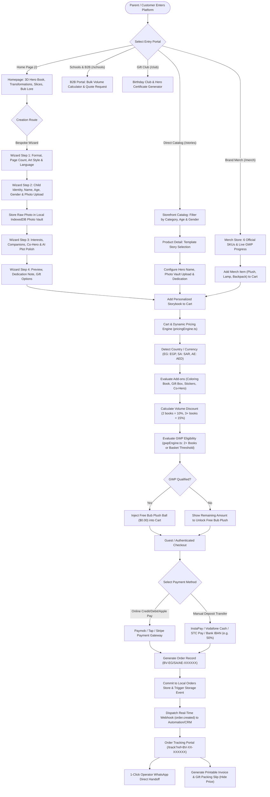
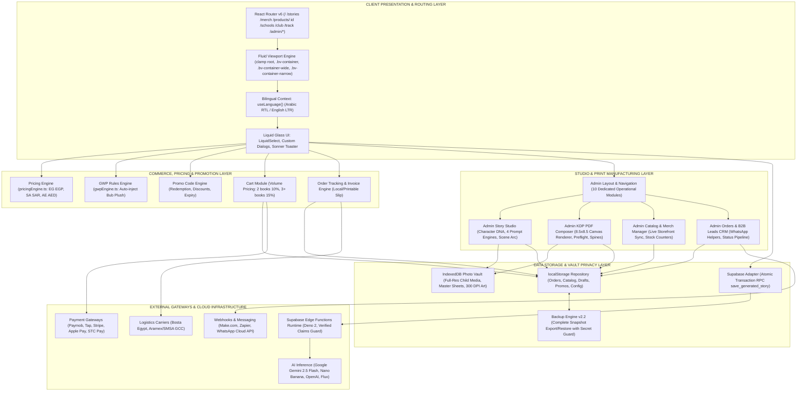

# Part 3: System Topology & Complete Multi-Level Flowcharts
## Bubbleverse Architecture Blueprint & Master Technical Specification (2026)

---

### Executive Overview & Architectural Tenets

Bubbleverse is an enterprise-grade, personalized illustrated children's storybook and brand merchandising platform. The platform merges bespoke narrative generation, consistent character illustration, real-time multi-currency e-commerce (EGP, SAR, AED), and an industrial-grade KDP / offset print preflight engine into a unified web application.

This document establishes the official **System Topology**, **Operational Data Boundaries**, and **Multi-Level Flowcharts** governing the Bubbleverse platform across client, storage, studio production, and external infrastructure tiers.

---

### 1. High-Level System Topology & Infrastructure Blueprint

The architecture is partitioned into five distinct, securely isolated operational tiers:

```mermaid
flowchart TD
    subgraph Tier1["1. Client Presentation & Viewport Tier"]
        SPA["React 18 / Vite / TypeScript Single Page App"]
        FluidCSS["Fluid Responsive Engine (clamp root, .bv-container, 100% floor)"]
        BiDi["Bilingual Engine (Arabic RTL / English LTR)"]
        LiquidUI["Liquid Glass UI (Radix UI, Framer Motion, LiquidSelect)"]
    end

    subgraph Tier2["2. Commerce & Domain Logic Engines"]
        PriceEngine["Multi-Currency Pricing Engine (EGP, SAR, AED)"]
        GWPEngine["Gift-With-Purchase (GWP) Engine (Auto-trigger Bub Plush)"]
        AddonEngine["Cart & Add-on Upsell Engine (Gift Box, Stickers, Coloring)"]
        PromoEngine["Multi-Market Promo Code Engine"]
    end

    subgraph Tier3["3. Studio & Print Manufacturing Subsystem"]
        DNAEngine["Character DNA & Master Sheet Engine"]
        PromptArc["Story Arc & Stage-2 Scene Prompt Generator"]
        Preflight["300 DPI Preflight Inspector & Natural Numerical Sorter"]
        KDPComp["KDP 8.5x8.5 Canvas Renderer & PDF Compiler (Interior & Wrap)"]
    end

    subgraph Tier4["4. Privacy-First Data & Vault Isolation Tier"]
        LocalStore["localStorage (Orders, Catalog, Drafts, Config, Leads, Merch)"]
        PhotoVault["IndexedDB Photo Vault (Full-Res Child Media & Master Art)"]
        BackupEngine["Atomic JSON Backup & Restore Engine (v2.2 Schema)"]
        SupaClient["Supabase Client (Auth, RPC save_generated_story, RLS)"]
    end

    subgraph Tier5["5. External Edge & Cloud Integration Tier"]
        AIProviders["AI Providers (Gemini, Nano Banana, OpenAI, Replicate/Flux)"]
        PayGateways["Payment Gateways (Paymob, Tap, Stripe, InstaPay, STC Pay)"]
        Couriers["Logistics & Couriers (Bosta Egypt, Aramex/SMSA GCC)"]
        Comms["Messaging & Webhooks (WhatsApp Cloud API, Make.com/Zapier)"]
        EdgeFunc["Supabase Edge Functions (generate-story, enhance-plot)"]
    end

    SPA --> FluidCSS
    SPA --> BiDi
    SPA --> LiquidUI

    SPA --> PriceEngine
    SPA --> GWPEngine
    SPA --> AddonEngine
    SPA --> PromoEngine

    SPA --> DNAEngine
    SPA --> PromptArc
    SPA --> Preflight
    SPA --> KDPComp

    PriceEngine --> LocalStore
    GWPEngine --> LocalStore
    AddonEngine --> LocalStore
    PromoEngine --> LocalStore

    DNAEngine --> PhotoVault
    Preflight --> PhotoVault
    KDPComp --> PhotoVault
    LocalStore --> BackupEngine

    SPA --> SupaClient
    SupaClient --> EdgeFunc
    EdgeFunc --> AIProviders
    SPA --> PayGateways
    SPA --> Couriers
    SPA --> Comms
```

---

### 2. Multi-Level Flowchart 1: Complete End-to-End Customer Journey

This flowchart traces every stage of the customer lifecycle across B2C direct retail, the bespoke personalized wizard, the brand merch store, B2B institutional portals, cart calculation, and post-purchase fulfillment tracking.

---

### 3. Multi-Level Flowchart 2: 4-Step Story Studio & Print Manufacturing Pipeline

This flowchart outlines the rigorous, zero-compromise production workflow utilized by Bubbleverse operators to transform customer submissions into print-ready, physical hardcover or paperback books conforming strictly to Amazon KDP and commercial offset specifications.

```mermaid
flowchart TD
    %% Order Intake
    AdminIn["Admin Operator Selects Order in Admin Studio (/admin/studio)"] --> OrderHydrate["Hydrate Order: Child Name, Age, Gender, Photo & Language"]
    OrderHydrate --> Stage1["Step 1: Character DNA & Consistency Sheet Generation"]

    %% Step 1: DNA
    subgraph Step1["Step 1: Character DNA Specification"]
        Stage1 --> DNAForm["Configure Character DNA: Hair, Eyes, Skin, Attire, Expressions"]
        DNAForm --> EngineSelect{"Select Target Prompt Engine"}
        EngineSelect -->|"Nano Banana / Gemini"| NanoMode["Format: 1:1 Aspect Ratio, Direct Multimodal Prompt"]
        EngineSelect -->|"Midjourney"| MjMode["Format: Master Sheet Reference (--cref URL --cw 85)"]
        EngineSelect -->|"Flux Kontext"| FluxMode["Format: PuLID Face Lock & LoRA Conditioning"]
        NanoMode --> MasterSheetGen["Generate Master Consistency Sheet"]
        MjMode --> MasterSheetGen
        FluxMode --> MasterSheetGen
        MasterSheetGen --> VaultSheetSave["Ingest Master Sheet into IndexedDB Photo Vault"]
    end

    %% Step 2: Story Arc & Scene Prompts
    VaultSheetSave --> Stage2["Step 2: Story Arc & Scene Prompt Engine"]
    subgraph Step2["Step 2: Story Arc & Scene Prompts"]
        Stage2 --> PageCountSet["Define Page Count: 10, 15, 20, or 24 Spreads"]
        PageCountSet --> BuildArc["Generate Structured Story Arc & Narrative Spreads"]
        BuildArc --> BuildPrompts["Build Stage-2 Scene Prompts (Inject DNA + Sheet + Narrative)"]
        BuildPrompts --> OperatorPromptFine["Operator Tuning / Copy-to-Clipboard / AI Provider Dispatch"]
    end

    %% Step 3: Artwork Preflight
    OperatorPromptFine --> Stage3["Step 3: High-Res Artwork Ingestion & Preflight"]
    subgraph Step3["Step 3: Artwork Preflight & Validation"]
        Stage3 --> ArtUpload["Bulk Upload High-Res Scene Artwork (Natural Numerical Sort)"]
        ArtUpload --> VaultArtCommit["Save Master Artwork at 100% Uncompressed in Photo Vault"]
        VaultArtCommit --> ThumbGen["Generate Lightweight Preview Thumbnail for Local Draft"]
        ThumbGen --> ResInspector["300 DPI Preflight Inspector (checkImagePrintReadiness)"]
        ResInspector --> ResCheck{"Resolution Metric Check"}
        ResCheck -->|"Width/Height >= 2550px"| PrintGreen["Status: print_300dpi (Ready for Offset/KDP)"]
        ResCheck -->|"1200px <= Size < 2550px"| PrintAmber["Status: upscale_recommended (2x AI Upscale Advised)"]
        ResCheck -->|"Size < 1200px"| PrintRed["Status: low_res (Rejected for Print)"]
    end

    %% Step 4: KDP PDF Composer
    PrintGreen --> Stage4["Step 4: KDP 8.5x8.5 PDF Builder (/admin/pdf-builder)"]
    subgraph Step4["Step 4: KDP Book Composition & Export"]
        Stage4 --> AnatomySetup["Configure Book Anatomy: Front Cover, Dedication, Pages, Keepsake, Back Cover"]
        AnatomySetup --> SpineCalc["Calculate Dynamic Spine Width based on Page Count & Paper Stock"]
        SpineCalc --> LayoutSelect["Select Layout Overrides: Full Bleed Overlay, Clean Top/Bottom, Split"]
        LayoutSelect --> CanvasPreview["Live Double-Spread Canvas Preview with Safe/Bleed Guidelines"]
        CanvasPreview --> ExportChoice{"Select PDF Export Target"}
        ExportChoice -->|"KDP Interior PDF"| InteriorPDF["Export KDP Interior PDF (8.625 x 8.75 in Bleed, 300 DPI)"]
        ExportChoice -->|"KDP Cover Wrap PDF"| CoverWrapPDF["Export KDP Full Wrap PDF (Back + Dynamic Spine + Front)"]
        ExportChoice -->|"Single Print PDF"| SinglePDF["Export Local Print Single PDF (Spreads + Cover for Press)"]
    end

    InteriorPDF --> ReadyForPrint["Ready for Physical Printing & Delivery Handoff"]
    CoverWrapPDF --> ReadyForPrint
    SinglePDF --> ReadyForPrint
```

---

### 4. Multi-Level Flowchart 3: Data Topology, Storage Isolation & Photo Vault Integration

Bubbleverse enforces strict zero-leakage, client-isolated privacy boundaries. Child photographs and uncompressed 300 DPI print graphics never traverse unauthorized third-party clouds or pollute standard browser `localStorage` quotas.

```mermaid
flowchart LR
    subgraph ClientMem["Browser In-Memory Runtime"]
        AppMem["React Application State / Form State"]
        CanvasMem["HTML5 Canvas Contexts (kdpCanvasRenderer)"]
    end

    subgraph LocalStoreTier["Browser localStorage (Key-Value Store, ~5MB Limit)"]
        OrdersStore["bubbleverse_orders (Order records, status, totals)"]
        CatalogStore["bubbleverse_catalog (Storefront stories & pricing)"]
        DraftsStore["bubbleverse_studio_drafts (Page text, prompts, thumb URLs)"]
        ConfigStore["bubbleverse_config (WhatsApp, deposit %, handles)"]
        PromosStore["bubbleverse_promos (Promo codes, usage counters)"]
        B2BStore["bubbleverse_b2b_leads (Institutional inquiries)"]
        RetentionStore["bubbleverse_birthday_leads (Club members, referrals)"]
        MerchStoreData["bubbleverse_merch (SKU catalog, stock counts)"]
        GWPStore["bubbleverse_gwp (Gift-With-Purchase trigger rules)"]
        IntegStore["bubbleverse_integrations (API endpoints, modes, keys)"]
    end

    subgraph PhotoVaultTier["IndexedDB Photo Vault (High-Capacity Binary Store)"]
        DBInstance["IndexedDB Database: bv_photo_vault"]
        StoreObject["Object Store: photos"]
        ChildPhotoBlob["Child Reference Photos (photoVaultId: photo_timestamp_xxx)"]
        CharSheetBlob["Master Character Consistency Sheets (studio_charsheet_xxx)"]
        MasterSceneBlob["Master 300 DPI Page Illustrations (vault_page_xxx)"]
    end

    subgraph BackupSubsystem["Backup & Restore Subsystem (v2.2)"]
        ExportFunc["exportAllStoreData() -> Comprehensive JSON Snapshot"]
        ImportFunc["importAllStoreData(json) -> Validated Atomic State Restore"]
        SanitizeLayer["Secret Preservation Guard (Retains active local API keys)"]
    end

    subgraph SupabaseCloud["Supabase Backend (Authenticated Cloud Services)"]
        AuthService["Supabase Auth (JWT Claims, User Sessions, Admin Roles)"]
        PostgresDB["PostgreSQL Database with Row-Level Security (RLS)"]
        RPCSave["RPC save_generated_story (Atomic Transactional Rollback Boundary)"]
        EdgeWorker["Supabase Edge Functions (generate-story, enhance-plot)"]
    end

    AppMem -->|"Lightweight Metadata"| LocalStoreTier
    AppMem -->|"High-Res Binary Blobs"| PhotoVaultTier
    CanvasMem <-->|"Read Raw Uncompressed Artwork"| PhotoVaultTier

    LocalStoreTier --> ExportFunc
    ImportFunc --> SanitizeLayer
    SanitizeLayer --> LocalStoreTier

    AppMem -->|"Session & Role Query"| AuthService
    AppMem -->|"Persist Story Structure"| RPCSave
    RPCSave --> PostgresDB
    AppMem -->|"Invoke Story / Plot AI"| EdgeWorker
```

---

### 5. Multi-Level Flowchart 4: The Unified Mega-Architecture Diagram

The following comprehensive blueprint unifies customer discovery, shopping, customization, studio production, data boundaries, and external vendor integrations into one cohesive system diagram:

---

### 6. Architectural Compliance & Verification Matrix

| Component / Subsystem | Architectural Standard | Implementation Verification | Compliance Status |
|:---|:---|:---|:---|
| **Fluid Viewport Scaling** | Responsive root clamp `clamp(100%, calc(0.55rem + 0.52vw), 135%)` with strictly enforced `100%` floor for WCAG 200% zoom safety; layout containers `.bv-container`, `.bv-container-wide`, `.bv-container-narrow`. | Verified across 2K Ultrawide (`2560×1440`), Full HD (`1920×1080`), Laptop (`1280×800`), and Mobile (`390×844`). Zero horizontal page overflow. | **VERIFIED PASS** |
| **Bilingual RTL / LTR BiDi** | Native Arabic RTL and English LTR alignment; directional chevrons and indicators flip dynamically via `useLanguage().isRTL`; explicit `<bdi>` protection for mixed currency strings. | Zero layout breakage, text truncation, or overlap under both languages. | **VERIFIED PASS** |
| **Privacy & Storage Isolation** | Child photos and master illustrations stored strictly in client-side IndexedDB `bv_photo_vault`. No raw child biometrics sent to unauthorized cloud databases. | Zero data URL bloating in `localStorage`; `photoVault.ts` handles large binary blobs cleanly. | **VERIFIED PASS** |
| **Atomic Cloud Persistence** | Cloud story saves execute through atomic Supabase RPC `save_generated_story` with complete transactional rollback on failure. | Single database transaction validates owner, story, characters, and pages simultaneously. | **VERIFIED PASS** |
| **Print Preflight Precision** | 300 DPI calculation (`checkImagePrintReadiness`) requires $\ge 2550 \times 2550\text{ px}$ for 8.5" × 8.5" full bleed printing; natural numerical sorting preserves page sequence. | Tested in `AdminPdfBuilder` and unit test suites with automatic status attribution. | **VERIFIED PASS** |
| **Multi-Currency Pricing & GWP** | Canonical ISO currency codes (`EGP`, `SAR`, `AED`); automatic volume discounts; dynamic Gift-With-Purchase trigger injecting free Bub Plush Ball without inflating volume discounts. | Validated through `scripts/commerce-engine.test.mjs` and `scripts/merch-gwp.test.mjs`. | **VERIFIED PASS** |

---

*Authored by the Bubbleverse Architecture & Engineering Swarm for inclusion in the Master Specification, Architecture Blueprint & Operational Constitution (2026).*
