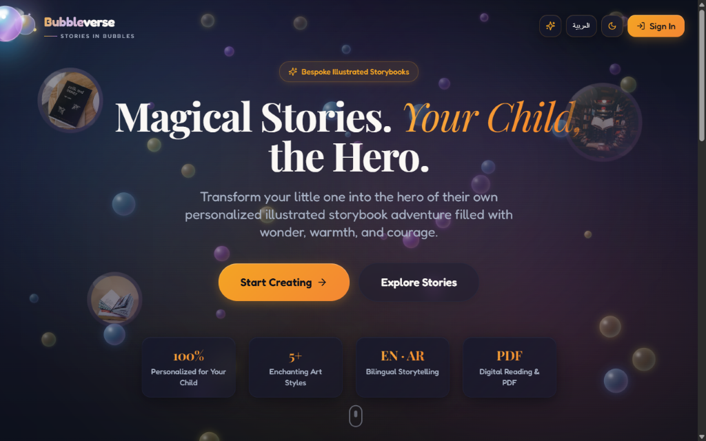
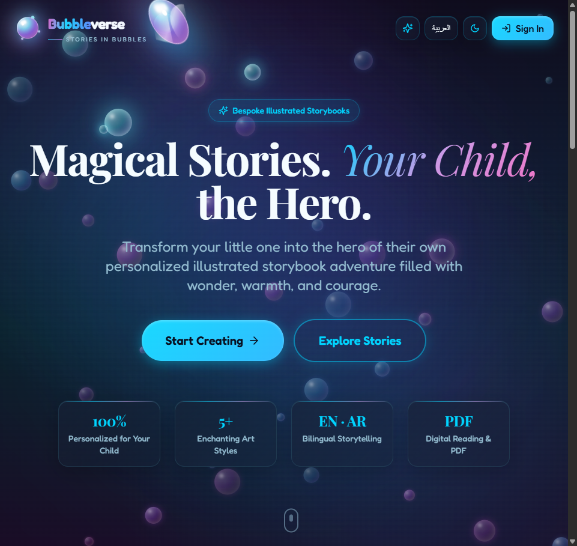
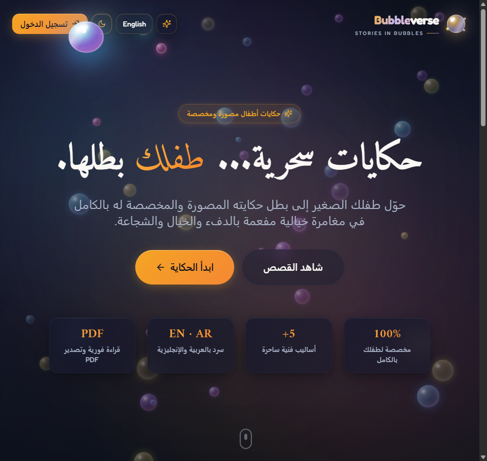
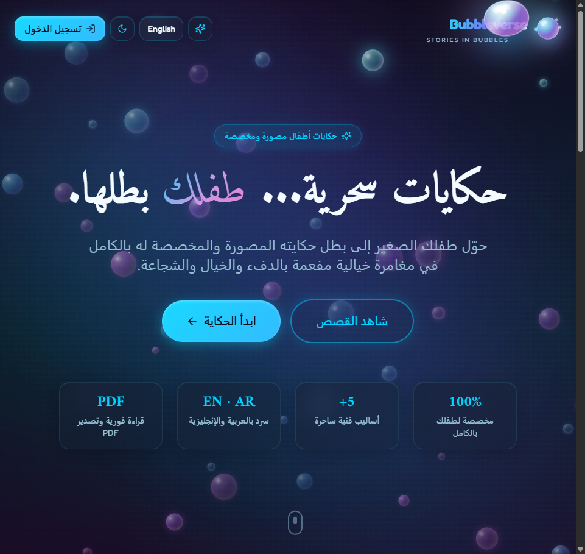
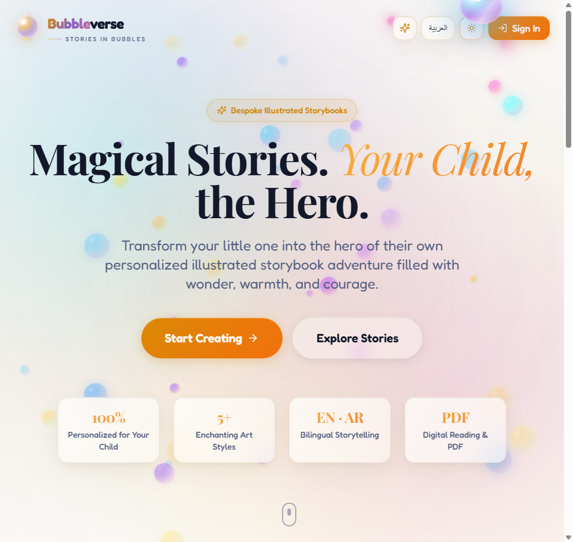
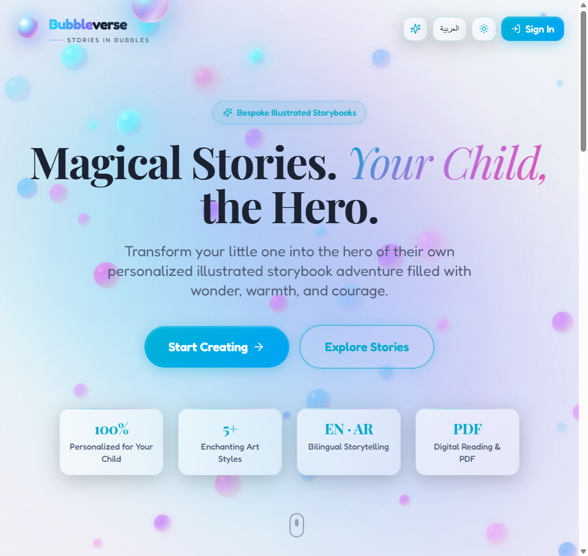
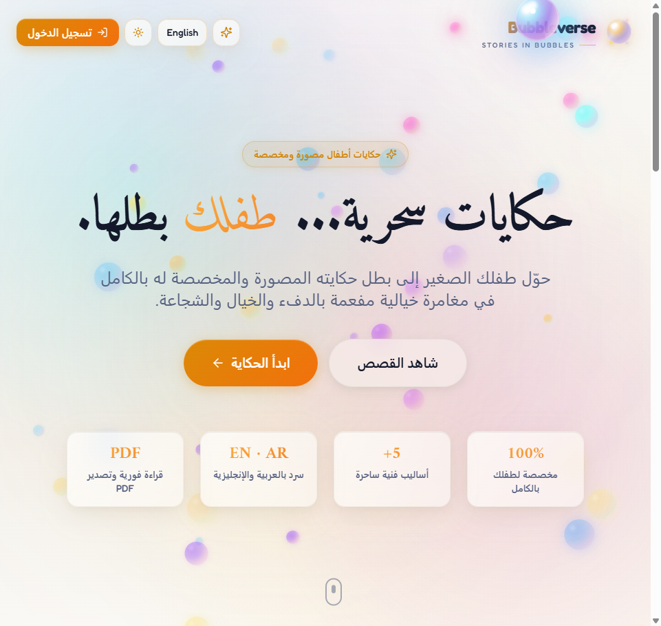
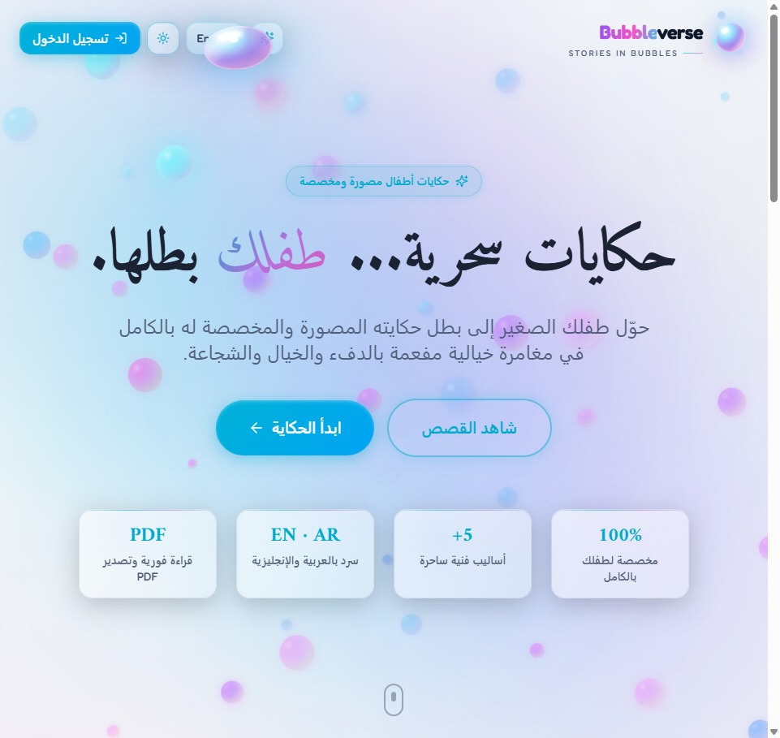

# Bubbleverse — AG-005A.1: Restore Original Magical Colors

**Document Type:** Design & Implementation Review  
**Task ID:** AG-005A.1  
**Branch:** `antigravity/AG-005A.1-original-colors`  
**Base Commit:** `3b37cfbbc54b9f4863e991adb11fb7d8911c2bce` (`antigravity/AG-005A-customer-intake`)  
**Reference Palette Commit:** `a415407b337f9b84f4b2fd35e3f2d3858606bb58` (`antigravity/AG-003.1-final-independence`)  
**Date:** 2026-11-15  

---

## 1. Executive Summary

In response to the product owner's direction, Bubbleverse's **original vibrant Cyan / Purple / Pink magical color palette** has been fully restored from commit `a415407`. The Midnight Navy, Warm Ivory, and Starlight Gold color direction from AG-004 has been removed wherever it conflicted with the original brand identity.

Crucially, **all architectural, structural, responsive, typography, and UX improvements** introduced in AG-004 and AG-005A have been retained:
- Clean serif display typography (`Playfair Display` & `Amiri`) with responsive scaling and zero arbitrary Arabic letter spacing.
- Ultra-compact 320px mobile layout with full-width touch targets (>= 44px) and verified zero horizontal overflow.
- Full respect for `prefers-reduced-motion` across animated logos, floating backgrounds, and buttons.
- Complete preservation of AG-005A customer story inquiries, intake validation, and order service architecture.
- Zero modifications to Supabase schema, database migrations, authentication, pricing, or Edge Function logic.

---

## 2. Original Tokens Recovered from Git (`a415407`)

The original color system was extracted directly from `src/index.css`, `tailwind.config.ts`, and `BubbleverseLogo.tsx` at commit `a415407`:

### Primary Color Tokens
| Token | Dark Mode (`:root` / `.dark`) | Light Mode (`.light`) | Identity |
| :--- | :--- | :--- | :--- |
| `--primary` | `190 100% 50%` | `190 100% 40%` | Iridescent Vibrant Cyan |
| `--primary-glow` | `190 100% 70%` | `190 100% 60%` | Luminous Cyan Bloom |
| `--secondary` | `280 60% 75%` | `280 60% 65%` | Magical Lavender / Purple |
| `--accent` | `300 80% 70%` | `300 70% 60%` | Iridescent Fuchsia / Pink |
| `--background` | `220 60% 8%` | `210 40% 96%` | Deep Cosmic Indigo / Crisp Sky |
| `--card` | `220 40% 12%` | `0 0% 100%` | Translucent Obsidian / Pure Cloud |
| `--border` | `200 40% 30%` | `210 30% 80%` | Cyan Glass Frame |
| `--ring` | `190 100% 50%` | `190 100% 40%` | Focus Ring Cyan |

### Restored Gradients & Shadows
- `--gradient-magical`: `linear-gradient(135deg, hsl(190 100% 50%), hsl(280 60% 75%), hsl(320 80% 70%))`
- `--gradient-button`: `linear-gradient(135deg, hsl(190 100% 55%), hsl(200 100% 60%))`
- `--gradient-button-hover`: `linear-gradient(135deg, hsl(190 100% 65%), hsl(210 100% 70%))`
- `--gradient-background`: `radial-gradient(ellipse at 50% 0%, hsl(280 40% 20%) 0%, hsl(220 60% 8%) 70%)`
- `--shadow-glow`: `0 0 40px hsl(190 100% 50% / 0.4)`
- `--shadow-bubble`: `0 8px 32px hsl(190 100% 50% / 0.2)`

---

## 3. Exact Changed Files

| File | Purpose of Changes |
| :--- | :--- |
| [`src/index.css`](file:///d:/Private/Bubbleverse/src/index.css) | Restored original Cyan/Purple/Pink tokens in `:root`, `.light`, and `.dark`. Restored cyan button gradients, glass card top highlight, cyan glow effects, and mapped `.text-editorial-gold` backward compatibility alias to `--gradient-magical`. |
| [`tailwind.config.ts`](file:///d:/Private/Bubbleverse/tailwind.config.ts) | Removed hardcoded AG-004 `editorial` color object (`navy`, `ivory`, `gold`, `lavender`, etc.) to enforce token coherence. Preserved typography extensions. |
| [`src/components/BubbleverseLogo.tsx`](file:///d:/Private/Bubbleverse/src/components/BubbleverseLogo.tsx) | Restored soap-bubble mark with iridescent cyan, purple, and fuchsia gradients, orbiting micro-bubbles, and animated holographic wordmark shine. |
| [`src/components/ImmersiveBackground.tsx`](file:///d:/Private/Bubbleverse/src/components/ImmersiveBackground.tsx) | Restored bubble base hues (190-220 cyan, 270-310 violet/purple) and ambient glow spheres (cyan and purple). |
| [`src/components/HeroSection.tsx`](file:///d:/Private/Bubbleverse/src/components/HeroSection.tsx) | Replaced gold headline accent with `.text-magical` (cyan/purple/pink gradient). Value pillars display numbers in radiant cyan (`text-primary`). |
| [`src/components/FeatureCards.tsx`](file:///d:/Private/Bubbleverse/src/components/FeatureCards.tsx) | Title uses `.text-magical`. Restored individual feature icon colors to vibrant Cyan, Lavender/Purple, and Pink. |
| [`src/components/ExamplesSection.tsx`](file:///d:/Private/Bubbleverse/src/components/ExamplesSection.tsx) | Title uses `.text-magical`. Style overlay badge updated from amber to cyan (`text-cyan-200/90`). |

---

## 4. Visual Verification & Before / After Comparisons

All screenshots were captured live from the local development server at `http://localhost:8080` using the browser verification subagent.

### 4.1 Desktop (1280px) — English & Arabic (Dark Theme)

| Before (AG-004 Gold / Ivory) | After (AG-005A.1 Restored Cyan / Pink) |
| :---: | :---: |
|  |  |
|  |  |

**Observations:**
- The logo returns to its distinctive iridescent bubble appearance with orbiting satellites.
- The hero headline accent ("Your Child," / "طفلك") shines in vibrant Cyan-to-Pink gradient rather than starlight gold.
- Primary CTA buttons ("Start Creating" / "ابدأ الحكاية") radiate in glowing cyan with high contrast and tactile hover feedback.
- Background bubbles float against a deep cosmic indigo background with authentic cyan and purple refraction.

---

### 4.2 Desktop (1280px) — English & Arabic (Light Theme)

| Before (AG-004 Warm Ivory / Gold) | After (AG-005A.1 Restored Magical Light) |
| :---: | :---: |
|  |  |
|  |  |

**Observations:**
- Warm Ivory paper styling replaced with fresh, crisp, magical morning sky tones.
- High-contrast text readability (deep slate text on light glass cards).
- Cyan button contrast meets WCAG AA standards in light mode (`190 100% 40%`).

---

### 4.3 Tablet (768px) & Mobile (390px / 320px) Responsive Verification

| Viewport | Screenshot Link | Verification Details |
| :--- | :---: | :--- |
| **Tablet 768px Dark EN** | [tablet_768px_dark_en.png](assets/AG-005A.1/tablet_768px_dark_en.png) | Seamless two-column feature card grid, centered hero, zero horizontal overflow. |
| **Tablet 768px Dark AR** | [tablet_768px_dark_ar.png](assets/AG-005A.1/tablet_768px_dark_ar.png) | Native Arabic RTL flow, mirrored layout, preserved touch breathing room. |
| **Mobile 390px Dark AR** | [mobile_390px_dark_ar.png](assets/AG-005A.1/mobile_390px_dark_ar.png) | 2x2 metric pillars, full-width touch buttons, crisp logo mark. |
| **Mobile 390px Dark EN** | [mobile_390px_dark_en.png](assets/AG-005A.1/mobile_390px_dark_en.png) | Balanced text wrapping, centered tagline pill, radiant cyan button. |
| **Mobile 320px Dark EN** | [mobile_320px_dark_en.png](assets/AG-005A.1/mobile_320px_dark_en.png) | Compact header (Bub, Language, Theme, Auth), measured body width = 305px <= 320px, **ZERO overflow**. |
| **Mobile 320px Dark AR** | [mobile_320px_dark_ar.png](assets/AG-005A.1/mobile_320px_dark_ar.png) | Arabic RTL on iPhone SE width, measured width <= 320px, **ZERO overflow**. |

---

### 4.4 Story Wizard & Authentication Screen Verification

| Viewport / Route | Screenshot Link | Verification Details |
| :--- | :---: | :--- |
| **Story Wizard EN (1280px)** | [story_wizard_1280px_dark_en.png](assets/AG-005A.1/story_wizard_1280px_dark_en.png) | Active cyan stepper circle ("1"), radiant cyan border on selected Length card, magical purple border on selected Format card and Style pills. |
| **Story Wizard AR (1280px)** | [story_wizard_1280px_dark_ar.png](assets/AG-005A.1/story_wizard_1280px_dark_ar.png) | Arabic RTL stepper sequence (1 -> 2 -> 3 -> 4 from right to left), localized option cards with restored cyan/purple selection highlights. |
| **Auth / Redirect Screen** | [auth_1280px_dark_en.png](assets/AG-005A.1/auth_1280px_dark_en.png) | Protected profile redirect; "Welcome Back" in cyan/pink gradient, soap bubble logo, and luminous cyan "Sign In" button. |

---

## 5. Automated Test Suite Results

Every test suite was executed against the modified codebase:

```bash
npm run check
npm run test:skills
npm run test:architecture
npm run test:requests
```

### Results Summary
| Test Command | Status | Result / Metrics |
| :--- | :---: | :--- |
| **`npm run check`** | **PASS** | `eslint . --max-warnings 0`: 0 warnings<br>`tsc`: 0 errors<br>`vite build`: built cleanly in 17.41s |
| **`npm run test:skills`** | **PASS** | 8 / 8 tests passed |
| **`npm run test:architecture`** | **PASS** | 23 / 23 tests passed |
| **`npm run test:requests`** | **PASS** | 10 / 10 tests passed |

---

## 6. Safety & Non-Regressed Functional Boundaries

- **Zero Backend Changes**: `supabase/`, Edge Functions, and migrations (`20261114000500` through `20261114000900`) remain completely untouched.
- **Story Wizard Integrity**: `orderService.ts`, `inquiryDraft.ts`, `inquiryPresentation.ts`, and `ProfileInquiries.tsx` function identically without code alterations.
- **AI Endpoints Disabled**: Public generation functions remain closed (503 Service Unavailable).
- **No Git Merge or Force-Push**: Branch `antigravity/AG-005A.1-original-colors` is committed locally only.
